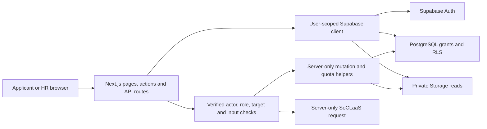
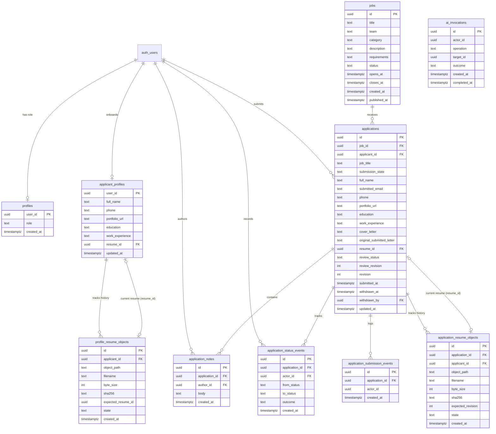
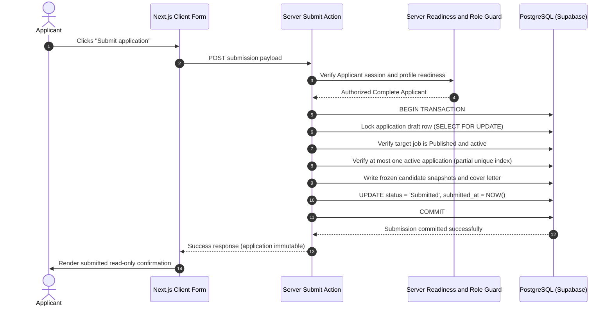
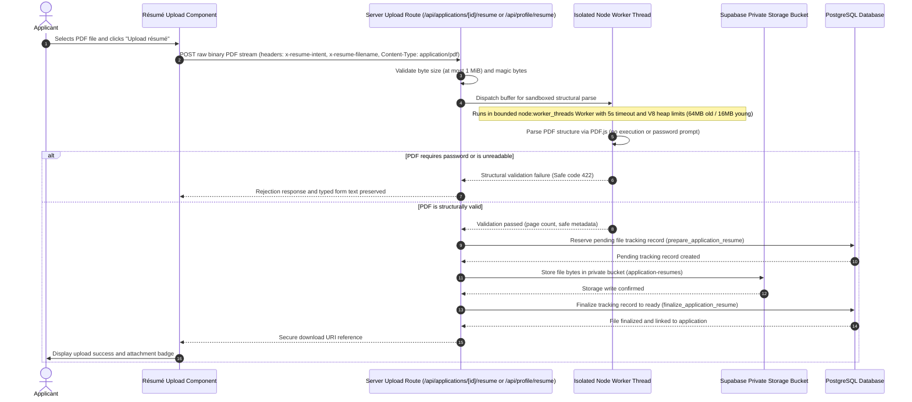
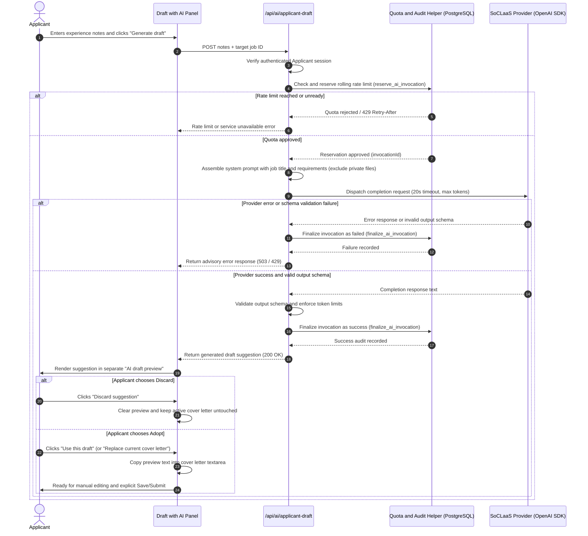
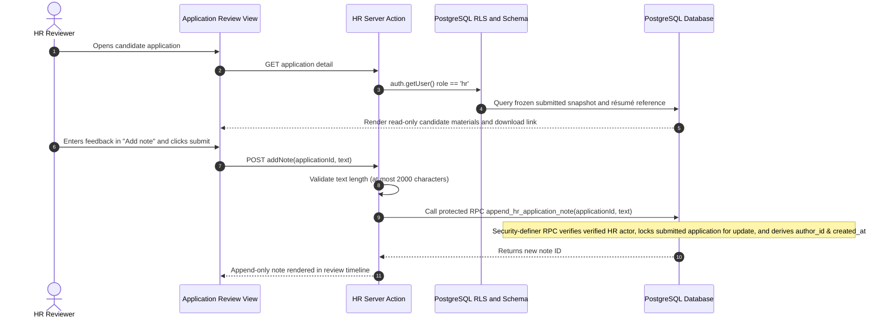
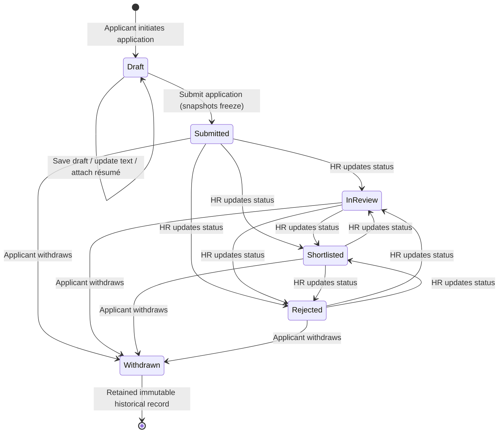
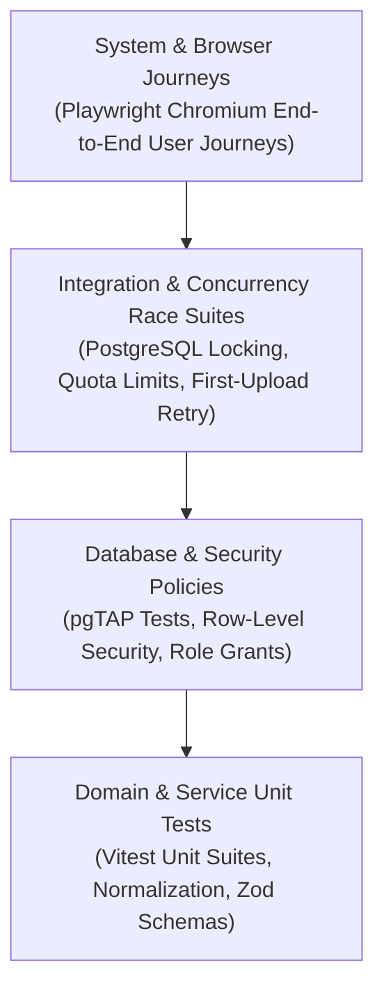
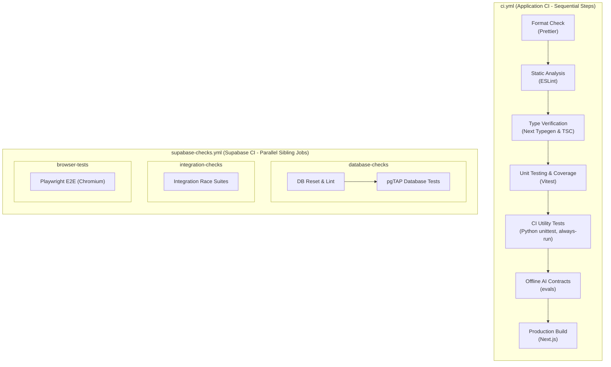

# ConnectTalent Developer Guide

This guide describes the current careers-portal implementation, local setup and the team's software engineering evidence. User actions are in the [User Guide](UserGuide.md). Requirements are authoritative in [workflow/specs](../workflow/specs/README.md), integrated PR #86 branch baseline **v1.14**.

Documentation reviewed on **12 October 2026**, against local `develop` at `c9678b6`. Paul reports the feature PRs merged. The team-supplied public URL is [cs3227-mp3.vercel.app](https://cs3227-mp3.vercel.app/). A public URL, merged code or local acceptance does not establish a working production release. Authenticated hosted smoke testing remains unverified here.

## 1. Development prerequisites

- Node.js **24 LTS**, the contribution/CI baseline, and **pnpm 12.8.1**, pinned in [package.json](../package.json). The runtime Node version is not pinned in that file.
- Git and Docker Desktop (running) or a compatible local container engine.
- Supabase CLI is a project development dependency; run it through `pnpm exec supabase`.
- Supabase/Vercel access for authorized hosted work. SoCLaaS access is needed only for live AI checks.

Install the pinned pnpm directly with `npm install --global pnpm@12.8.1`. If your environment uses Corepack, `corepack pnpm` can replace `pnpm` in these commands. Product runtime configuration and the lockfile determine the stack; no native installer, Java/Gradle build or SDD toolkit is used.

## 2. Getting started

### 2.1 Run from source

Start Docker Desktop, then in the repository:

```powershell
pnpm install
Copy-Item .env.example .env.local
pnpm db:start
pnpm exec supabase status
```

Do not overwrite an existing `.env.local`; copy the example only for first setup. Fill its local URL/keys from status output and keep that output private. Then:

```powershell
pnpm dev
```

Open the printed URL, usually `http://localhost:3000`. Local accounts do not automatically work on the hosted website; Local, Development and Production databases maintain separate accounts. Local Supabase API is `http://127.0.0.1:54321`, Studio `http://127.0.0.1:54323`, Mailpit `http://127.0.0.1:54324`. Mailpit captures local verification and password recovery emails on port 54324 instead of sending them to Gmail. Recovery preserves your role; check Mailpit when testing recovery locally. Use the same browser/host when requesting and opening Auth links. Verification status note (16 October 2026): instructions are checked against development source and accepted specifications; authenticated hosted workflows remain unverified until checked on the deployed version.

For existing local data, apply reviewed pending migrations with `pnpm exec supabase migration up --local`. If merged migrations have older timestamps, inspect history before using `--include-all`. `pnpm db:reset` deliberately erases/recreates the local database and reapplies migrations/seed; it is not the default fix for an error. Stop with `pnpm db:stop`.

### 2.2 Environment configuration

Use [.env.example](../.env.example); `.env.local` is ignored. Never put real credentials in committed files or guide examples.

| Variable                                                    | Purpose / boundary                                                                                                                                 |
| ----------------------------------------------------------- | -------------------------------------------------------------------------------------------------------------------------------------------------- |
| `NEXT_PUBLIC_SUPABASE_URL`                                  | Select the intended local or hosted Supabase project.                                                                                              |
| `NEXT_PUBLIC_SUPABASE_PUBLISHABLE_KEY`                      | Public client key; user permissions still depend on Auth, grants and RLS.                                                                          |
| `SUPABASE_SECRET_KEY` or legacy `SUPABASE_SERVICE_ROLE_KEY` | Server-only runtime key for narrowly checked résumé mutations/cleanup and AI quota/audit RPCs. Required for file uploads even when AI is disabled. |
| `SOCLAAS_AI_ENABLED`                                        | AI is opt-in; enable only with valid server configuration.                                                                                         |
| `SOCLAAS_BASE_URL`, `SOCLAAS_API_KEY`, `SOCLAAS_MODEL`      | Server-only OpenAI-compatible SoCLaaS configuration, not the commercial OpenAI endpoint.                                                           |
| `APP_SITE_URL`                                              | Optional local/non-Vercel trusted origin override; local default is localhost:3000.                                                                |
| `TEST_SUPABASE_SERVICE_ROLE_KEY`                            | Local test/seed administration only. Not a runtime fallback or hosted test credential.                                                             |
| `LOCAL_HR_SEED_PASSWORD`                                    | Chosen local synthetic HR password, 8–72 characters.                                                                                               |

Only the public URL/key use `NEXT_PUBLIC_`. Vercel production Auth origins use `VERCEL_PROJECT_PRODUCTION_URL`; previews use `VERCEL_URL`. [site-url.ts](../src/lib/supabase/site-url.ts) validates origins. Supabase Auth needs the matching callback allowlist, including recovery. Preview deployment protection can prevent external users from following callbacks; test on a deliberately accessible environment.

### 2.3 Local HR account

Set the local `TEST_SUPABASE_SERVICE_ROLE_KEY` and chosen `LOCAL_HR_SEED_PASSWORD` in ignored `.env.local`, then:

```powershell
pnpm seed:local-hr
```

Sign in as **local-hr@example.test** using your chosen password. [seed-local-hr.mjs](../scripts/seed-local-hr.mjs) uses the Auth admin API, verifies its synthetic marker/verified account/no applications, assigns HR and reconciles the password. It refuses non-loopback endpoints and unrelated accounts at that email; it does not auto-login or create a hosted evaluator account. [seed.sql](../supabase/seed.sql) seeds job data, not login accounts.

### 2.4 Quality and build commands

| Command                                        | What it checks / prerequisite                                                                                   |
| ---------------------------------------------- | --------------------------------------------------------------------------------------------------------------- |
| `pnpm format:check`                            | Prettier formatting. Use scoped `pnpm exec prettier --write <files>` for your owned edits.                      |
| `pnpm lint`                                    | ESLint, Next rules and configured complexity/size limits.                                                       |
| `pnpm exec next typegen` then `pnpm typecheck` | Generated route types and TypeScript; no database/browser proof.                                                |
| `pnpm test:unit`                               | Vitest units.                                                                                                   |
| `pnpm test:unit:coverage`                      | V8 text/HTML/LCOV/JSON coverage under `coverage/`; CI reports four metrics against an informational 90% target. |
| `pnpm test:db`                                 | Local pgTAP database permissions/lifecycle tests; Supabase running with migrations.                             |
| `pnpm test:integration`                        | Five local race suites for application, AI quota, withdrawal, profile résumé and first-upload coordination.     |
| `pnpm test:e2e:critical` / `pnpm test:e2e`     | Critical/all Chromium browser journeys; local services and fixtures required.                                   |
| `pnpm build` then `pnpm start`                 | Local production build/server, not deployment.                                                                  |

Install the browser with `pnpm exec playwright install chromium`. Local browser suites use privileged synthetic fixtures; without `TEST_SUPABASE_SERVICE_ROLE_KEY`, relevant tests skip. A skipped test is not a pass. Unlike the HR seed command, plain Playwright does not load that key from `.env.local` automatically. In PowerShell, export only the needed local test value before running:

```powershell
foreach ($line in Get-Content .env.local) {
  if ($line -match '^TEST_SUPABASE_SERVICE_ROLE_KEY=(.*)$') {
    $env:TEST_SUPABASE_SERVICE_ROLE_KEY = $Matches[1].Trim().Trim('"').Trim("'")
  }
}
pnpm test:e2e
```

Use local synthetic data only. Race suites also require local Docker/PostgreSQL access; inspect each script's fixture/setup requirements. [playwright.config.ts](../playwright.config.ts) defaults to localhost:3000 and `pnpm dev`, supports `PLAYWRIGHT_BASE_URL` / `PLAYWRIGHT_SERVER_COMMAND`, and reuses a local server. For another port, align application Auth origins and allowed callbacks too.

## 3. Product definition

### 3.1 Goal and roles

One employer uses this deployment to advertise multiple jobs and review applications. There is no multi-company marketplace or employer selector. Paul owns the Applicant/HR workflow contribution; John owns AI-feature work, as recorded by the team discussion and [individual reflections](Reflections.md).

### 3.2 Current capabilities

- Published job/category browsing; HR draft creation/editing, explicit publication and closure.
- Verified Applicant signup, sign-in/out, password recovery and required private profile onboarding.
- New-form profile autofill; private drafts; required submitted contacts and immutable letter/background/file snapshots.
- Optional private profile/application PDF files, explicit independent reuse, upload-before-save and lost-response recovery.
- Submitted-only HR review with candidate search, job/status/withdrawal filters, sorting and pagination; private add-only notes, human status changes, and retained terminal owner withdrawal.
- Optional Applicant cover-letter drafting and advisory HR summaries through server-only SoCLaaS.

Non-goals: multi-tenancy, public HR signup, job reopening/deletion, submitted-content editing, withdrawal undo, PDF extraction/AI résumé processing, automatic hiring or AI status writes. Reapplication is supported through a new record while the job is active; it does not restore or alter the withdrawn submission. No application-data erasure workflow is implemented.

### 3.3 Target User Profile and Personas

ConnectTalent is built for single-organization talent acquisition, serving two primary operational user roles alongside administrative personnel:

| Persona Role                         | Operational Responsibilities                                                                                                                                                                                                                                              | Technical Profile                                                                                                            | Key Requirements and Ergonomic Needs                                                                                                                                                                               |
| ------------------------------------ | ------------------------------------------------------------------------------------------------------------------------------------------------------------------------------------------------------------------------------------------------------------------------- | ---------------------------------------------------------------------------------------------------------------------------- | ------------------------------------------------------------------------------------------------------------------------------------------------------------------------------------------------------------------ |
| **Guest / Job Seeker**               | Browse published vacancies, search across titles and job requirements, filter by team categories.                                                                                                                                                                         | General public user; accesses via desktop or mobile web browsers.                                                            | Immediate access to published openings without forced authentication; fast phrase search; responsive filtering.                                                                                                    |
| **Registered Applicant**             | Complete profile details, upload private PDF résumé, draft job applications, generate AI-assisted cover letter drafts, submit immutable applications, track review status, and withdraw when necessary.                                                                   | Comfortable with modern web applications; demands confidentiality of contact details and draft materials.                    | Pre-filled application forms from profile; private drafts unreadable by HR; clear visual confirmation of submission; explicit preview before adopting AI suggestions; clear status tracking.                       |
| **HR Specialist / Reviewer**         | Author job postings, configure optional scheduled opening/closing windows, publish and close vacancies, inspect submitted applications, download applicant résumés, record attributed private notes, update candidate review statuses, and request advisory AI summaries. | Human resources professional; demands efficient batch review, clear audit trails, and distraction-free candidate inspection. | Fast navigation across candidate submissions; strict separation from unsubmitted drafts; immutable applicant snapshots; add-only private notes invisible to applicants; AI-assisted summary with source grounding. |
| **System Administrator / Evaluator** | Provision dedicated HR roles via database administrative queries, configure deployment environment secrets, oversee AI rate limits and audit logs, and conduct verification runs.                                                                                         | Experienced with cloud operations, PostgreSQL access, and deployment workflows.                                              | Strict server-side and database-level authorization (RLS); clear separation between synthetic local seeds and production credentials; least-privilege administrative access.                                       |

### 3.4 Prioritized User Stories

Priorities reflect product necessity:

- `* * *` : Essential / High Priority (Core MVP)
- `* *` : Important / Medium Priority
- `*` : Desirable / Low Priority

#### 3.4.1 Account, Identity and Profile Onboarding Stories

| Priority | Persona Role | User Story Text                                                                                                                                                               | Business Rationale and Acceptance Criteria                                                                                                                  |
| :------: | ------------ | ----------------------------------------------------------------------------------------------------------------------------------------------------------------------------- | ----------------------------------------------------------------------------------------------------------------------------------------------------------- |
| `* * *`  | Applicant    | As an applicant, I want to create and verify my account using email and password, so that my applications and profile remain securely private to me.                          | Enforces password complexity; requires email link verification before application access; public signup creates Applicant accounts only.                    |
| `* * *`  | Applicant    | As an authenticated applicant, I want to complete my required profile details (name and international phone number), so that future applications can be accurately contacted. | Directs incomplete profiles strictly to profile onboarding; gates application and vacancy apply actions until profile fields are saved.                     |
|  `* *`   | Applicant    | As an applicant, I want to store my education, work experience, portfolio URL, and a default PDF résumé in my profile, so that I can reuse them across multiple applications. | Profile persists optional background fields and private PDF; validates telephone calling code and national number syntax via international phone standards. |
|  `* *`   | User         | As a registered user, I want to recover my password via email verification, so that I can regain account access without compromising my role.                                 | Password recovery link verifies identity; password update preserves existing account role and does not alter submitted applications.                        |

#### 3.4.2 Job Discovery, Search and Category Filtering Stories

| Priority | Persona Role      | User Story Text                                                                                                                                                        | Business Rationale and Acceptance Criteria                                                                                                            |
| :------: | ----------------- | ---------------------------------------------------------------------------------------------------------------------------------------------------------------------- | ----------------------------------------------------------------------------------------------------------------------------------------------------- |
| `* * *`  | Guest / Applicant | As a visitor, I want to browse currently open vacancies and filter by department category, so that I can discover relevant career opportunities.                       | Only published jobs within their active scheduling window are visible; category filter groups vacancies cleanly.                                      |
| `* * *`  | Guest / Applicant | As a visitor, I want to search open roles using keyword phrases across titles, teams, descriptions, and requirements, so that I can quickly locate specific positions. | Case-insensitive literal phrase matching; server-side sanitization; debounced input updates URL search params for bookmarking and history navigation. |
|  `* *`   | Guest / Applicant | As a visitor, I want clear feedback while search queries or navigation actions are loading, so that I know the system is actively retrieving results.                  | Action buttons display pending feedback (such as searching indicators) and disable duplicate submissions during transit.                              |

#### 3.4.3 Job Lifecycle and HR Management Stories

| Priority | Persona Role | User Story Text                                                                                                                                                        | Business Rationale and Acceptance Criteria                                                                                                      |
| :------: | ------------ | ---------------------------------------------------------------------------------------------------------------------------------------------------------------------- | ----------------------------------------------------------------------------------------------------------------------------------------------- |
| `* * *`  | HR Reviewer  | As an HR reviewer, I want to create draft job listings with title, team, category, description, and requirements, so that openings can be prepared before publication. | Only authenticated HR users can access job management; drafts remain hidden from public listings and search.                                    |
| `* * *`  | HR Reviewer  | As an HR reviewer, I want to publish draft vacancies and optionally schedule future opening and closing times, so that application windows are managed automatically.  | Scheduled jobs become visible only once the opening time arrives; past closing time, public view and submissions are automatically disabled.    |
| `* * *`  | HR Reviewer  | As an HR reviewer, I want to manually close an active job, so that applications cease immediately while retaining historical records.                                  | Manual closure immediately halts new drafts and submissions; existing submitted records remain readable to HR and applicants.                   |
|  `* *`   | HR Reviewer  | As an HR reviewer, I want to revert a scheduled job back to draft status before it opens, so that content or scheduling details can be revised.                        | Reverting is allowed only before the opening time; once open, published listing content is immutable to preserve candidate application context. |

#### 3.4.4 Application Drafting, Résumé and Submission Stories

| Priority | Persona Role | User Story Text                                                                                                                                               | Business Rationale and Acceptance Criteria                                                                                                                |
| :------: | ------------ | ------------------------------------------------------------------------------------------------------------------------------------------------------------- | --------------------------------------------------------------------------------------------------------------------------------------------------------- |
| `* * *`  | Applicant    | As an applicant, I want new application forms to prefill my saved profile data, so that I can apply efficiently without retyping common information.          | Automatically populates contact details, background, and gives option to attach profile résumé; existing drafts take precedence over later profile edits. |
| `* * *`  | Applicant    | As an applicant, I want to save private draft applications, so that I can complete my submission over multiple sessions without HR viewing incomplete drafts. | Private drafts are accessible only to the applicant; server enforces row-level security so HR cannot inspect unsubmitted drafts.                          |
| `* * *`  | Applicant    | As an applicant, I want to upload a private PDF résumé directly to my application or profile, so that reviewers can inspect my full credentials.              | Validates PDF structure and byte limits in an isolated sandboxed worker; rejects password-protected or corrupt files; stores in private buckets.          |
| `* * *`  | Applicant    | As an applicant, I want to submit my application with mandatory contact details and cover letter, so that HR can evaluate my candidacy.                       | Submission freezes candidate details, contact snapshots, and attached résumé; prevents post-submission editing while job is open.                         |
|  `* *`   | Applicant    | As an applicant, I want upload retry recovery if network interruption occurs during résumé upload, so that I do not lose typed cover letter content.          | Separates file upload state from form text saving; allows retrying failed upload without clearing typed application fields.                               |

#### 3.4.5 Application Withdrawal and Reapplication Stories

| Priority | Persona Role | User Story Text                                                                                                                                              | Business Rationale and Acceptance Criteria                                                                                                    |
| :------: | ------------ | ------------------------------------------------------------------------------------------------------------------------------------------------------------ | --------------------------------------------------------------------------------------------------------------------------------------------- |
| `* * *`  | Applicant    | As an applicant, I want to withdraw a submitted application if my circumstances change, so that HR knows I am no longer actively pursuing the role.          | Withdrawal requires confirmation; marks the submission permanently withdrawn; retains immutable audit history for both applicant and HR.      |
|  `* *`   | Applicant    | As an applicant, I want to submit a new application for a job I previously withdrew from, provided the role remains open, so that I can reapply if eligible. | Database enforces at most one active application per applicant per job via partial unique index; permits new draft creation after withdrawal. |

#### 3.4.6 HR Application Review, Attributed Notes and Status Stories

| Priority | Persona Role | User Story Text                                                                                                                                                            | Business Rationale and Acceptance Criteria                                                                                              |
| :------: | ------------ | -------------------------------------------------------------------------------------------------------------------------------------------------------------------------- | --------------------------------------------------------------------------------------------------------------------------------------- |
| `* * *`  | HR Reviewer  | As an HR reviewer, I want to view all submitted applications and their review statuses on a central dashboard, so that candidate pipelines can be tracked.                 | Dashboard displays metrics across jobs and review states; application review table lists submitted candidates with immutable snapshots. |
| `* * *`  | HR Reviewer  | As an HR reviewer, I want to add private, attributed notes to an application, so that internal hiring deliberations are documented without exposing them to the applicant. | Notes are append-only, timestamped, attributed to the authoring HR reviewer, and protected by RLS against applicant reads.              |
| `* * *`  | HR Reviewer  | As an HR reviewer, I want to transition application review status between In Review, Shortlisted, and Rejected, so that candidates are categorized accurately.             | Transitions are recorded in status history; applicant can view updated status on their application detail; Submitted is initial-only.   |
|  `* *`   | HR Reviewer  | As an HR reviewer, I want withdrawn applications to remain readable as historical records while blocking new notes or status changes, so that records are preserved.       | Freezes review actions on withdrawn applications; maintains view access for candidate history and audit compliance.                     |

#### 3.4.7 Advisory AI Drafting and Grounded Summary Stories

| Priority | Persona Role | User Story Text                                                                                                                                                           | Business Rationale and Acceptance Criteria                                                                                                        |
| :------: | ------------ | ------------------------------------------------------------------------------------------------------------------------------------------------------------------------- | ------------------------------------------------------------------------------------------------------------------------------------------------- |
| `* * *`  | Applicant    | As an applicant, I want optional AI assistance to generate a draft cover letter from my supplied experience notes, so that I have a structured starting point.            | Requires explicit human review; renders suggestion in separate preview; existing letter remains untouched until user chooses to adopt suggestion. |
| `* * *`  | HR Reviewer  | As an HR reviewer, I want an optional AI summary of candidate submissions with grounded evidence excerpts, so that I can identify strengths and follow-up topics quickly. | Server-only execution; strictly advisory with no mutation authority; returns grounded source excerpts and potential follow-up questions.          |
|  `* *`   | System Admin | As an administrator, I want durable rate limits and token caps enforced on AI operations, so that third-party provider quotas and budgets are protected.                  | Enforces per-user and deployment-wide rolling window request limits; validates inputs and outputs against strict schemas.                         |

### 3.5 Formal Use Cases

#### UC01: Verified Applicant Registration and Onboarding Gate

- **Actor**: Unauthenticated Job Seeker
- **Preconditions**: User has an accessible email address.
- **Main Success Scenario**:
  1. User accesses sign-up page, enters email address, password (minimum complexity requirements), and password confirmation.
  2. System validates input, creates pending Auth record, and dispatches verification link.
  3. User opens verification link in browser on the requesting host.
  4. System verifies email, establishes authenticated session with `Applicant` role, and redirects to **My profile**.
  5. User is restricted to **My profile** until mandatory profile fields (full name and formatted international phone number) are entered and saved.
  6. Upon saving, system persists the validated fields, making the derived profile readiness check pass and unlocking access to Careers and application workflows.
- **Extensions**:
  - 1a. Password does not meet length requirements or confirmation does not match.
    - System keeps entered email, displays clear inline validation guidance, and keeps form open.
  - 3a. Verification link expired or opened in inconsistent context.
    - System redirects to sign-in with a notice advising the user to check their details and verify their email before trying again.
  - 5a. User attempts to navigate directly to job application routes before completing profile.
    - Server guard intercepts request and redirects back to **My profile** with an onboarding prompt.

#### UC02: Applicant Profile Maintenance and Telephony Normalization

- **Actor**: Authenticated Complete Applicant
- **Preconditions**: Applicant is signed in with a completed profile.
- **Main Success Scenario**:
  1. Applicant navigates to **My profile**.
  2. Applicant edits telephone calling code, national digits, portfolio URL, education, or work experience.
  3. Applicant selects **Save profile**.
  4. System validates phone number format according to international telephony standards, updates profile record, and displays success notification.
- **Extensions**:
  - 2a. Telephone number contains invalid characters or combined calling code and national digits total outside 7–15 digits.
    - System rejects update and displays field-level formatting instructions requiring a valid E.164-compatible phone number (7–15 digits).
  - 2b. Portfolio URL contains embedded credentials or invalid scheme.
    - System rejects update and prompts for valid HTTP(S) URL.

#### UC03: Public Job Discovery, Category Filtering and Keyword Search

- **Actor**: Guest or Authenticated Applicant
- **Preconditions**: One or more jobs are in `Published` status within their active schedule window.
- **Main Success Scenario**:
  1. Visitor opens **Careers** portal.
  2. System displays active published vacancies with title, team, category, and description.
  3. Visitor selects a category filter (e.g. Engineering, Sales, Legal, HR, Other).
  4. System refreshes list to display vacancies matching the selected category.
  5. Visitor enters a keyword phrase into the search input.
  6. System debounces input, normalizes whitespace, sanitizes search terms, and updates URL parameters.
  7. Results matching the phrase across title, team, description, or requirements are displayed.
- **Extensions**:
  - 2a. Job is in `Draft` status or scheduled with a future opening time.
    - System excludes the job from public queries; direct URL requests return not found.
  - 7a. No open jobs match the combined search and category criteria.
    - System renders an informative empty state suggesting query adjustments without throwing errors.

#### UC04: HR Job Draft Creation, Scheduling and Publication

- **Actor**: Authenticated HR Reviewer
- **Preconditions**: User holds the verified `hr` role.
- **Main Success Scenario**:
  1. HR reviewer navigates to **Manage jobs** and selects **Create draft**.
  2. HR enters title, team, category, description, and requirements.
  3. HR optionally specifies scheduled opening and scheduled closing timestamps.
  4. HR saves the draft; system validates required fields and persists job with status `Draft`.
  5. HR reviews draft and selects **Publish job**.
  6. System persists job status as `published`; if scheduled opening is in the future, the HR interface derives and displays the operational label `Scheduled` (public listings remain hidden until `opens_at`), and if opening is empty or in the past, the vacancy becomes immediately visible in public search.
- **Extensions**:
  - 3a. Scheduled closing time is chronologically earlier than or equal to scheduled opening time.
    - System rejects save with schedule validation warning.
  - 5a. HR chooses to revert a job with operational label `Scheduled` before its opening time.
    - System returns stored job status to `draft`, allowing further content revisions.
  - 6a. HR selects **Close job** on an active listing.
    - System sets status to `Closed`; public listings and submissions cease immediately while historical applications remain accessible.

#### UC05: Application Draft Creation, Profile Autofill and Persistence

- **Actor**: Authenticated Complete Applicant
- **Preconditions**: Job is currently `Published` and active; applicant has no active application for this job.
- **Main Success Scenario**:
  1. Applicant navigates to an open vacancy and chooses **Apply for this role**.
  2. System checks profile readiness and verifies no active application exists.
  3. System initializes an in-memory application form, prefilling name, email, phone, and optional background from saved profile without creating a database row.
  4. Applicant enters or edits cover letter text and selects **Save draft**.
  5. System validates draft ownership and persists a private draft application record. HR cannot view the draft.
- **Extensions**:
  - 1a. Applicant already has an active submitted application for the job.
    - System displays existing application detail view and prevents creating duplicate draft.
  - 4a. Applicant navigates away before saving.
    - Form remains unpersisted; unsaved typed text is discarded without warning upon navigation or refresh.

#### UC06: Private PDF Résumé Upload and Structural Validation

- **Actor**: Authenticated Applicant
- **Preconditions**: Application draft exists or profile edit view is open.
- **Main Success Scenario**:
  1. Applicant selects a PDF file and clicks **Upload résumé**.
  2. Browser submits raw binary PDF body with `x-resume-intent: upload` and `x-resume-filename` headers to the secure upload endpoint (`/api/applications/[id]/resume` or `/api/profile/resume`).
  3. Server inspects file size (maximum 1 MiB) and passes buffer to an isolated Node worker thread (`node:worker_threads`).
  4. Worker executes PDF structural validation via PDF.js under strict memory and execution deadlines without rendering or executing embedded scripts.
  5. File passes structural inspection without requiring passwords; server creates a pending tracking record in the database, uploads file bytes to private Storage, and finalizes the tracking record to link the file to the draft.
  6. UI renders private download link and update controls.
- **Extensions**:
  - 3a. File exceeds 1 MiB byte limit.
    - Server rejects upload with HTTP 413 Payload Too Large; previous attachment is preserved.
  - 4a. PDF requires a password to open or is structurally unreadable.
    - Server rejects upload with HTTP 422 Unprocessable Entity; displays guidance that password-protected files are not accepted.
  - 4b. Worker execution exceeds timeout or worker crashes.
    - Server terminates worker, returns safe 503/504 error code without exposing internal diagnostics, and preserves typed form content.

#### UC07: Application Submission and Content Snapshot Freezing

- **Actor**: Authenticated Applicant
- **Preconditions**: Active application draft exists with required fields completed; job remains open and active.
- **Main Success Scenario**:
  1. Applicant reviews application details and selects **Submit application**.
  2. Server executes transactional validation: verifies applicant profile readiness, non-empty cover letter within length limits, and job active status.
  3. Server takes an immutable snapshot of applicant full name, verified email, formatted phone number, background fields, cover letter, and finalized résumé reference.
  4. Server atomically updates application status to `Submitted`, records submission timestamp, and invalidates draft state.
  5. Applicant view updates to read-only submitted detail; application becomes visible in HR review queue.
- **Extensions**:
  - 2a. Job reached closing time or was closed by HR before submission commit.
    - Server rejects submission with notification that the listing is closed; draft text is preserved.
  - 2b. Mandatory fields (e.g. cover letter or verified phone) are missing.
    - Form highlights missing fields with validation feedback; status remains draft.

#### UC08: Application Withdrawal and Safe Reapplication

- **Actor**: Authenticated Applicant
- **Preconditions**: Applicant has an existing `Submitted` application.
- **Main Success Scenario**:
  1. Applicant navigates to **My applications** and opens the submitted application.
  2. Applicant selects **Withdraw application**.
  3. System presents confirmation dialog explaining that withdrawal is permanent for this record.
  4. Applicant confirms withdrawal.
  5. Server marks record status as `Withdrawn`, timestamps `withdrawn_at`, and preserves the frozen snapshot and review history as audit records.
  6. While the vacancy remains open and active, applicant is permitted to initiate a fresh application for the same role if desired.
- **Extensions**:
  - 4a. Applicant chooses **Keep application**.
    - System cancels dialog and keeps submission active in review.
  - 6a. Applicant attempts to reapply after the job has closed.
    - System forbids new draft creation for closed vacancies.

#### UC09: HR Application Review and Attributed Private Notes

- **Actor**: Authenticated HR Reviewer
- **Preconditions**: One or more submitted applications exist.
- **Main Success Scenario**:
  1. HR reviewer navigates to **Application review** and selects an applicant submission.
  2. System loads immutable candidate snapshot, cover letter, and secure download link for attached résumé.
  3. Reviewer enters assessment feedback into **Add note** (up to character limit) and submits.
  4. Server persists note as an add-only record attributed to the reviewer's authenticated user ID with timestamp.
  5. Note renders in chronological internal notes feed; applicant cannot access or view notes.
- **Extensions**:
  - 2a. Application was withdrawn by applicant.
    - Snapshot and existing notes remain readable as historical records; **Add note** control is disabled.
  - 3a. Note exceeds maximum allowable character limit.
    - Validation prevents submission and prompts user to shorten the note.

#### UC10: HR Review Status Progression and Auditing

- **Actor**: Authenticated HR Reviewer
- **Preconditions**: Submitted application is open in HR review.
- **Main Success Scenario**:
  1. HR reviewer reviews candidate credentials and selects a new review status: `In review`, `Shortlisted`, or `Rejected`.
  2. Server verifies caller holds `hr` role, updates application review status, and inserts an audit entry into status transition history.
  3. Updated status badge displays immediately in HR interface and becomes visible to the applicant in their application view.
- **Extensions**:
  - 1a. Reviewer attempts to transition a withdrawn application.
    - Server rejects transition; withdrawn state is terminal.
  - 2a. Concurrent update detected.
    - Server handles conflict cleanly and prompts reviewer to refresh view.

#### UC11: Applicant AI Cover Letter Drafting with Explicit Preview Adoption

- **Actor**: Authenticated Applicant
- **Preconditions**: Application draft is open; AI feature is enabled; user is within rolling request quota.
- **Main Success Scenario**:
  1. Applicant opens **Draft with AI** panel on the application form.
  2. Applicant inputs experience notes (up to character limit) describing their background and role interest.
  3. Applicant selects **Generate draft**.
  4. Server validates rate quota, constructs scoped prompt with job title, published job requirements, and applicant notes (excluding job description, private profile fields, and files), and dispatches request to SoCLaaS provider.
  5. Provider returns generated draft adhering to strict token constraints.
  6. System displays output in a separate **AI draft preview** container; current cover letter remains unchanged.
  7. Applicant reviews suggestion and chooses **Use this draft** (or **Replace current cover letter**).
  8. System copies preview text into the active cover letter textarea for manual editing; applicant explicitly saves draft or submits.
- **Extensions**:
  - 3a. User exceeds rolling rate quota (e.g. 3 requests per rolling minute).
    - Server returns rate limit message; applicant is advised to wait before retrying or continue manually.
  - 6a. Applicant selects **Discard suggestion**.
    - System clears preview container; existing cover letter text remains completely untouched.

#### UC12: HR Grounded AI Application Summary and Advisory Excerpts

- **Actor**: Authenticated HR Reviewer
- **Preconditions**: Submitted application is open in review; AI feature is enabled.
- **Main Success Scenario**:
  1. HR reviewer selects **Summarize** (or **Refresh summary** for subsequent runs) on candidate submission view.
  2. Server verifies HR authorization, checks deployment quota, and compiles submitted cover letter and job requirements.
  3. Server dispatches request to SoCLaaS provider with strict formatting instructions and brevity limits.
  4. Provider returns two arrays of zero-based sentence IDs (evidence and unaddressed requirements) adhering to strict output constraints without generating prose or text.
  5. Server validates returned IDs, extracts grounded excerpts from candidate submission and job requirements, and deterministically generates neutral interview follow-up questions.
  6. System renders advisory summary cards alongside original candidate materials.
- **Extensions**:
  - 1a. AI provider is unreachable or returns error.
    - System displays non-disruptive advisory error message; candidate application and review controls remain fully functional.
  - 4a. Summary is generated for informational reference only.
    - AI has zero authority to mutate review status, candidate ranking, or application records; human reviewer retains sole decision authority.

### 3.6 Product Specifications in Gherkin Syntax

```gherkin
Feature: Applicant Account Verification and Required Profile Onboarding
  As a prospective job applicant
  I want to create a verified account and complete mandatory onboarding
  So that my private details are protected and my applications can be contacted

  Scenario: Applicant Signup and Verification Email Dispatch
    Given a visitor enters an unregistered email "candidate@example.com"
    And enters matching passwords satisfying complexity rules
    When the visitor submits the account creation form
    Then a new unverified applicant account is initialized
    And a verification email containing a secure callback link is dispatched
    And public signup does not grant HR administrative privileges

  Scenario: Incomplete Profile Onboarding Gate Enforcement
    Given a newly verified applicant signs in for the first time
    When the applicant navigates to any application or careers route
    Then the system redirects the applicant to "My profile"
    And displays guidance that full name and international phone number are required
    When the applicant provides a valid full name and formatted international telephone number
    And selects "Save profile"
    Then the derived profile readiness check passes
    And access to career listings and application submission is unlocked

  Scenario: Rejection of Invalid International Telephone Format
    Given an applicant is updating their profile
    When the applicant enters an invalid calling code or non-numeric national phone number
    And clicks "Save profile"
    Then the profile update is rejected
    And descriptive telephone formatting guidance is displayed
```

```gherkin
Feature: Applicant Profile Maintenance and Telephony Validation
  As an authenticated applicant
  I want to maintain my contact details, background information, and international telephony
  So that future applications prefill accurately with verified contact information

  Scenario: Update Profile Details and Validate Telephony
    Given an applicant has completed onboarding
    When the applicant navigates to "My profile"
    And updates education, work experience, and phone calling code with valid national digits
    And selects "Save profile"
    Then the profile record is updated successfully
    And subsequent job applications prefill with the updated profile values

  Scenario: Rejection of Disallowed Portfolio URL Schemes
    Given an applicant is updating their profile
    When the applicant enters a portfolio URL containing embedded credentials or non-HTTP protocols
    And clicks "Save profile"
    Then the system rejects the portfolio URL
    And displays guidance to supply a valid HTTP or HTTPS address without credentials
```

```gherkin
Feature: Public Job Search and Vacancy Lifecycle Visibility
  As a careers portal visitor
  I want to search and filter published job listings
  So that I can identify active positions matching my skills

  Scenario: Search Published Jobs by Keyword Phrase
    Given multiple jobs exist in "Published", "Draft", and "Closed" statuses
    When a visitor enters search phrase "Full Stack"
    Then only jobs in "Published" status matching "Full Stack" in title, team, description, or requirements are displayed
    And draft jobs and closed jobs are strictly excluded from results
    And the URL search parameters update to reflect the query

  Scenario: Scheduled Vacancy Opening and Automatic Visibility
    Given a job is published with a scheduled opening time in the future
    When visitors browse the careers portal prior to the opening time
    Then the scheduled job is hidden from public listings and search
    When the scheduled opening time passes
    Then the job automatically becomes visible in public search without manual republishing
```

```gherkin
Feature: HR Job Vacancy Authoring, Scheduling, and Lifecycle Management
  As an HR reviewer
  I want to create, schedule, publish, and close job postings
  So that talent acquisition campaigns are accurately controlled over time

  Scenario: Author Draft Job and Publish Immediately
    Given an authenticated HR reviewer
    When the reviewer creates a job draft with title, team, category, description, and requirements
    And leaves scheduled opening and closing times blank
    And clicks "Publish job"
    Then the job status transitions to "Published"
    And the vacancy becomes immediately discoverable in the public careers portal

  Scenario: Scheduled Vacancy Opening and Revert to Draft
    Given an HR reviewer authors a job with a scheduled opening time in the future
    When the reviewer publishes the vacancy
    Then the job displays the derived operational label "Scheduled" while persisted as published
    And the job remains hidden from public applicants
    When the HR reviewer chooses "Revert to draft" prior to the opening time
    Then the status returns to "Draft" allowing further edits

  Scenario: Explicit Vacancy Closure
    Given a job is currently active in "Published" status
    When an HR reviewer selects "Close job"
    Then the job status changes to "Closed"
    And the vacancy ceases accepting new application drafts and submissions immediately
```

```gherkin
Feature: Application Drafting and Private Form Persistence
  As a registered applicant
  I want to save private draft applications
  So that I can compose my materials iteratively without premature disclosure

  Scenario: New Application Profile Prefill
    Given an applicant with a completed profile opens an application for an open role
    When the application form renders
    Then full name, verified email, phone number, and background fields are prefilled from profile
    And the form fields are initialized in memory without creating a database row until an explicit save or upload
    And any subsequent draft saved by the applicant remains completely invisible to HR reviewers

  Scenario: Explicit Draft Saving and Field Preservation
    Given an applicant is composing a cover letter in a draft application
    When the applicant enters custom text and clicks "Save draft"
    Then the draft is persisted to the database
    And subsequent updates to the applicant's profile do not overwrite the saved draft content
```

```gherkin
Feature: Private PDF Résumé Upload and Sandboxed Structural Validation
  As an applicant
  I want to attach a private PDF résumé to my application
  So that reviewers can evaluate my qualifications securely

  Scenario: Successful PDF Attachment Upload
    Given an applicant selects a valid PDF file within 1 MiB size limit
    When the applicant selects "Upload résumé"
    Then the server delegates parsing to an isolated worker process
    And the worker verifies PDF structure without executing embedded code
    And the file is uploaded to the private storage bucket
    And a secure reference is attached to the application record

  Scenario: Rejection of Password-Protected PDF
    Given an applicant attempts to upload a PDF that requires a password to open
    When the server worker validates the file
    Then the upload is rejected with a validation notice
    And no storage bytes are finalized
    And any previously attached valid résumé remains intact
```

```gherkin
Feature: Application Submission and Immutable Snapshot Freezing
  As an applicant
  I want to submit my completed application
  So that HR can review my qualifications

  Scenario: Submit Application and Freeze Submitted Snapshot
    Given an applicant has an open draft for an active published job
    And the cover letter and required contact details are filled
    When the applicant selects "Submit application"
    Then the application status transitions to "Submitted"
    And candidate contact details, background, cover letter, and résumé reference freeze into an immutable snapshot
    And the applicant is prevented from modifying the submitted text
    And the submission becomes visible in the HR review dashboard

  Scenario: Reject Submission on Closed Vacancy
    Given a job reaches its scheduled closing time or is manually closed by HR
    When an applicant attempts to submit an existing draft application
    Then the submission is rejected
    And the system informs the applicant that the vacancy has closed
    And existing draft text is preserved without corruption
```

```gherkin
Feature: Application Withdrawal and Safe Reapplication
  As an applicant
  I want to withdraw a submitted application and retain the option to reapply
  So that my active candidacy accurately reflects my availability

  Scenario: Permanent Application Withdrawal
    Given an applicant has an application in "Submitted" status
    When the applicant opens the application and confirms withdrawal
    Then the application status transitions to "Withdrawn"
    And the withdrawal timestamp is recorded
    And the snapshot and review history remain preserved for compliance
    And HR review actions on the withdrawn application are disabled

  Scenario: Reapplication After Withdrawal on an Open Job
    Given an applicant has a "Withdrawn" application for an active published job
    When the applicant visits the job listing and chooses to apply again
    Then a new separate draft application is created
    And the previously withdrawn application record remains unchanged in history
```

```gherkin
Feature: HR Application Review and Attributed Private Notes
  As an HR reviewer
  I want to document candidate assessments with attributed internal notes
  So that hiring deliberations are organized and private from candidates

  Scenario: Record Add-Only Internal Note
    Given an HR reviewer is viewing a submitted application
    When the reviewer enters assessment notes and clicks "Add note"
    Then the note is stored with the reviewer's authenticated user ID and timestamp
    And the note appears in the internal application review feed
    And the note is strictly inaccessible to the applicant via API or UI
```

```gherkin
Feature: HR Candidate Review Status Progression and Audit Logging
  As an HR reviewer
  I want to update candidate review statuses and preserve transition history
  So that hiring decisions maintain an accountable and auditable progression timeline

  Scenario: Progress Application Review Status
    Given an HR reviewer is evaluating an application in "Submitted" status
    When the reviewer selects "In review" and clicks "Update status"
    Then the application review status updates to "In review"
    And a corresponding record is inserted into the status transition audit log
    And the applicant can view the updated review status in "My applications"

  Scenario: Disallow Status Progression on Withdrawn Application
    Given an application has been withdrawn by the applicant
    When an HR reviewer attempts to update its review status
    Then the status transition is rejected
    And the withdrawn terminal state remains unchanged
```

```gherkin
Feature: AI Cover Letter Drafting with Explicit Preview Adoption
  As an applicant
  I want optional AI assistance to generate a cover letter draft
  So that I have an initial framework to refine manually

  Scenario: Generate AI Draft and Explicitly Adopt into Form
    Given an applicant has entered experience notes in "Draft with AI"
    When the applicant clicks "Generate draft"
    Then an advisory draft is generated within token constraints
    And the draft is presented in a separate "AI draft preview" container
    And the active cover letter textarea remains unchanged
    When the applicant clicks "Use this draft"
    Then the preview text is transferred to the cover letter textarea
    And the applicant can edit and explicitly save the draft
```

```gherkin
Feature: HR Grounded Advisory AI Application Summary
  As an HR reviewer
  I want an advisory AI summary highlighting candidate qualifications
  So that I can prepare interview discussions efficiently

  Scenario: Generate Grounded Summary for Candidate Application
    Given an HR reviewer is inspecting a submitted application
    When the reviewer clicks "Summarize"
    Then the provider returns selected sentence IDs without generating prose
    And the server maps IDs to source excerpts and generates neutral follow-up questions
    And the candidate's review status remains completely unchanged
    And AI possesses zero automated authority to reject, shortlist, or grade candidates
```

### 3.7 Non-Functional Specifications

1. **Performance and Responsiveness**:
   - Public job searches execute debounced client updates with rapid server filtering; pagination and category switching render without full page refresh lag.
   - Action controls provide instant visual feedback (e.g. pending labels and disabled duplicate submission states) to prevent repeated user requests during network transit.
2. **Security and Access Control**:
   - Supabase Auth manages cryptographically hashed credentials; role authorization is enforced strictly via PostgreSQL Row-Level Security (RLS) policies and server-side route guards.
   - Résumé PDF parsing executes in an isolated Node worker process with constrained memory heap limits and strict execution deadlines, mitigating parser-level vulnerabilities.
   - All third-party AI provider credentials remain exclusively server-side; API endpoints validate session authorization prior to dispatching requests.
3. **Data Integrity and Auditability**:
   - Applications execute snapshot freezing upon submission: applicant contact details, background, cover letter, and résumé references are permanently recorded as submitted snapshots.
   - Database uniqueness constraints enforce at most one active application per candidate per vacancy via partial indexing, preserving withdrawn records for historical auditability.
   - HR notes are add-only and immutable; status transitions maintain complete actor and timestamp logs.
4. **Ergonomics and Usability**:
   - Responsive layouts accommodate mobile, tablet, and desktop viewports with accessible color contrast and readable typography.
   - Contextual error messages guide users through input correction (e.g. phone formatting, PDF file type, or password complexity) without clearing unsaved form fields.

## 4. Specifications and implementation map

The [product index](../workflow/ProductSpec.md) links nine modules and identifies the current accepted baseline. Stable IDs connect issues, deltas, tasks, tests and review. This documentation-only correction does not change product requirements.

| Specification / IDs                                                | Implementation                                                                                                    |
| ------------------------------------------------------------------ | ----------------------------------------------------------------------------------------------------------------- |
| [Overview / OVR](../workflow/specs/product-overview.md)            | Single-employer scope, separate roles/routes.                                                                     |
| [Accounts / ACC](../workflow/specs/accounts-and-roles.md)          | `src/app/auth`, `src/lib/auth.ts`, `hr-auth.ts`, `account-navigation.ts`, `profile-readiness.ts`, `src/proxy.ts`. |
| [Public jobs / JOB](../workflow/specs/public-job-listings.md)      | Home/job routes, `src/lib/jobs.ts`, `job-categories.ts`.                                                          |
| [Job management / JMG](../workflow/specs/job-management.md)        | `src/app/hr/jobs`, `src/lib/hr-jobs.ts`, `hr-job-input.ts`.                                                       |
| [Applications / APP](../workflow/specs/applications-and-review.md) | Applicant/HR routes, application/profile/file modules, withdrawal and HR actions.                                 |
| [Applicant AI / AID](../workflow/specs/applicant-ai-draft.md)      | `/api/ai/applicant-draft`, applicant AI component and `src/lib/ai`.                                               |
| [HR AI / AIS](../workflow/specs/hr-ai-summary.md)                  | `/api/ai/hr-summary`, HR AI component and grounded-summary modules.                                               |
| [Security / SEC](../workflow/specs/security-and-privacy.md)        | Server guards/validation, SQL grants/RLS/functions, Storage, AI quota/audit.                                      |
| [Operations / OPS](../workflow/specs/deployment-and-operations.md) | Auth origins, CI, team-managed Vercel/Supabase environments and release evidence.                                 |

## 5. Architecture and data design



### 5.1 Responsibility boundaries

[src/app](../src/app) owns pages and transport/action orchestration; [src/components](../src/components) owns presentation/forms; [src/lib](../src/lib) owns focused validation, queries and services. Reuse genuine shared behavior, retaining explicit Applicant/HR policy. The root layout renders role-aware navigation; page/action guards and RLS remain authoritative because layouts can be reused during navigation.

`auth.getUser()` verifies identity; database `profiles.role` supplies controlled role assignment, not editable user metadata. Incomplete Applicants have a restricted verified session for `/profile`; proxy redirects and server guards deny other product operations until readiness. SQL also checks profile/submission fields, independently of hidden controls. Guest browsing and verified HR remain separate.

Public job search (`JOB-004`, #78) validates the single `q` URL parameter on the server, normalizes whitespace, and limits it to 100 Unicode characters. [job-search.ts](../src/lib/job-search.ts) matches a literal case-insensitive phrase against public title/team/description/requirements. The existing publishable-key reader fetches every published/category page before filtering; search text is never inserted into PostgREST expressions. Sorting and onboarding guards are preserved. This retains the existing all-row read cost; debounce is not rate limiting.

[JobListingFilters](../src/components/job-listing-filters.tsx) renders a native GET form and category links. Its [controller](../src/lib/job-filter-controller.ts) coordinates a 300 ms debounce, composition, immediate actions and history restoration; the [hook](../src/components/use-job-listing-filters.ts) connects it to the Next router. Automatic updates replace history; explicit changes push. Server-rendered results remain separate from client controls. No database migration, dependency or hosted setting is required. Local implementation evidence is in the [#78 record](../workflow/archive/2026-10-14-job-listing-search/record.md); hosted validation remains pending.

The [#84 change packet](../workflow/archive/2026-10-15-remaining-action-feedback/record.md) covers action-specific pending feedback for Applicant application Save/Submit, résumé mutations and error-page retry. The application form uses React form status to identify the submitted intent while preserving native validation. The résumé hook tracks active intent and retry separately from its existing operation ID; it does not alter the upload protocol. The error boundary wraps reset in a React transition. Local browser checks exercise delayed Save, Upload and Retry; real delayed Submit and error-boundary reset remain verification limits until separately tested. #81 Auth/HR controls and #83 route links are separate changes.

Issue #83 adds a disabled **Searching…** state to the Search submit button during the existing route transition; query/category/Clear remain usable for newer intent. The result-level progress announcement stays available to assistive technology without a duplicate visible line. The small [link status component](../src/components/pending-link-status.tsx) uses Next 16 `useLinkStatus` inside View role, Apply and Careers return links, preserving real hrefs and route authorization. The [#83 packet](../workflow/archive/2026-10-15-navigation-loading/record.md) and [View role follow-up](../workflow/archive/2026-10-15-view-role-loading/record.md) record local checks; hosted latency and a full assistive-technology review remain pending.

### 5.2 Data and lifecycle

[supabase/migrations](../supabase/migrations) defines jobs, role profiles, Applicant profiles, applications, HR notes/status events, file lifecycle metadata and AI invocation/audit metadata. A partial unique index on `(applicant_id, job_id) WHERE (withdrawn_at IS NULL)` enforces at most one active application while preserving withdrawn history and permitting reapplication. Supabase Auth owns account identity; submitted email is snapshotted from verified Auth, not browser input.

Jobs move Draft → Published → Closed. Only draft content is editable. Applications remain owner-private until submission, which freezes contacts, background, letters and finalized file references. Revision checks and ordered locks serialize save/submit/job closure/file operations; stale requests fail rather than silently overwrite. Legacy missing snapshots remain null and display Not provided.

Withdrawal retains submitted rows/files and prior review history, adds owner/time lifecycle metadata, and forbids subsequent HR processing. Repeated withdrawal reconciles the same committed state. Applicants who have withdrawn can create and submit a new application for the same job while it remains open. An already dispatched AI call cannot be recalled; eligibility is rechecked before returning results.

#### 5.2.1 Relational Entity-Relationship Model



### 5.3 Private PDF lifecycle

PDFs are optional, ≤1 MiB, validated structurally with filename/type/byte limits in a bounded worker. Buckets `application-resumes` and `profile-resumes` are private. User-session RLS/Storage controls downloads; browsers do not receive privileged keys or public/signed file URLs.

The PDF.js parser accepts encrypted documents only when they open without a supplied password. It inspects page structure without rendering, extracting text or executing embedded actions; this is not malware scanning. Stored bytes remain unchanged. A Node worker uses a 5-second deadline and 64/16 MiB V8 heap limits (these are not a total process-memory cap), is terminated on every outcome, and does not forward parser diagnostics. `next.config.ts` traces the PDF.js modules and platform canvas dependency required during module loading.

The three résumé upload endpoints share safe error codes and messages: empty/name/read failures return 400, oversized files 413, unsupported types 415, unreadable/password-required PDFs 422, validator unavailability 503 and timeout 504. Parser and infrastructure exceptions are not returned to users. File validation precedes Storage writes. New parser behavior and production tracing require hosted smoke testing before release.

Mutation routes validate Origin/actor/target/input before narrowly privileged reserve → upload → finalize operations. First upload can allocate a blank owned draft without saving typed fields. Explicit profile reuse creates independent application bytes, not a mutable shared reference. Invalid files are rejected before allocation/recovery.

Interrupted first-upload Retry resolves the owned persisted revision only when no client revision was supplied; explicit revisions retain stale-write checks. Current implementation splits this behavior into [application-resume-retry.ts](../src/lib/application-resume-retry.ts) and [application-resume-uploads.ts](../src/lib/application-resume-uploads.ts). See the [accepted repair evidence](../workflow/archive/2026-10-10-first-upload-retry/record.md).

Cleanup retains unreferenced deleting tombstones after best-effort Storage removal because older in-flight uploads may finish later. Later mutations retry exact tracked keys; there is no scheduled sweeper or guaranteed cleanup after all workers disappear. Never remove referenced files or arbitrary bucket prefixes. Structural validation is not antivirus scanning.

### 5.4 HR access and provisioning

HR reads submitted snapshots, not drafts or mutable Applicant profiles/files. Notes are add-only, private to HR, ≤2,000 characters and attributed. Separate human status actions change among In review/Shortlisted/Rejected; Submitted is initial-only. Withdrawn records are read-only to HR.

A designated administrator provisions hosted HR in the intended project using a dedicated verified account without applications. Existing approved provisioning query:

```sql
update public.profiles as p set role = 'hr'
where p.user_id = '<verified-user-uuid>'::uuid
  and exists (
    select 1 from auth.users as u
    where u.id = p.user_id and u.email_confirmed_at is not null
  )
  and not exists (
    select 1 from public.applications as a where a.applicant_id = p.user_id
  )
returning p.user_id, p.role;
```

Exactly one returned row establishes the assignment. Record authorized operator/target/time privately; no public promotion endpoint or shared password is provided. This is an operation requiring its own authorization, not performed by following this documentation update.

### 5.5 AI security and human control

The locally implemented #94/#95 follow-up adds request-origin/media guards, a fixed provider endpoint and bounded response transport, explicit Applicant preview/adoption, and offline adversarial contracts. See [AI security and evaluations](https://github.com/CS3227-2610-MP3-ConnectTalent/CS3227-2610-MP3/blob/ea85872/docs/AISecurityEvaluations.md) for the four-question evidence map, commands, actual live failures, human rubric and rollout limits. `test:ai-evals` is offline; `test:ai-evals:live` is manual operator tooling requiring its own explicit budget and pre-run safety review. The 16 October run exhausted its 24-call authorization. Do not rerun it under that approval.

OpenAI's SDK is an OpenAI-compatible client for SoCLaaS. Both endpoints authorize the selected job/application using the user's RLS session before provider use. Structured contact/background fields and PDFs are excluded; user-written notes/letters may still contain personal information. Treat all job/letter text as untrusted, not authority.

Strict schemas validate inputs/output; provider requests have a 20-second timeout, no automatic retry and at most one call per request. Durable SQL quota RPCs enforce three requests per user per rolling minute and 24 provider requests per deployment per rolling minute across both features. Notes ≤4,000 characters; letters ≤5,000; draft output ≤500 provider tokens; summary ≤350. Display arrays have at most five items of 240 characters. HR sentence selections are validated and rendered using source excerpts; grounding does not prove complete or correct semantic coverage.

AI has no tools or status/submission/note mutation authority. Outputs are escaped and advisory. Metadata-only audit/quota records exclude private content; errors return safe messages. The [AI packet](../workflow/archive/2026-10-09-soclaas-ai/record.md) and [security spec](../workflow/specs/security-and-privacy.md) retain actual checks and limitations.

### 5.6 Operational Sequence and State Diagrams

#### 5.6.1 Application Submission and Snapshot Freeze Flow



#### 5.6.2 Sandboxed PDF Résumé Upload and Validation Flow



#### 5.6.3 AI Cover Letter Generation and Explicit Adoption Flow



#### 5.6.4 HR Application Review and Attributed Notes Flow



#### 5.6.5 Application Lifecycle and Reapplication State Machine



*Note: Withdrawn applications are terminal historical records. Reapplying on an active job creates a separate application record rather than reopening the withdrawn record.*

### 5.7 Architectural and Design Decisions

This section documents the key architectural and technical design decisions made throughout ConnectTalent, detailing their rationale, alternatives considered, and trade-offs.

#### 5.7.1 Server-Side Role Enforcement and Supabase Row-Level Security (RLS)

- **Decision**: Enforce role-based access control (RBAC) at two independent server layers: server-side Next.js route/action guards and PostgreSQL Row-Level Security (RLS) policies on every database table.
- **Rationale**: Relying on UI-level hiding of controls or client-side checks provides zero security guarantees against direct API calls or compromised client sessions. PostgreSQL RLS ensures that even if an application route check is misconfigured, the database engine refuses unauthorized reads and writes at the row level.
- **Alternatives Considered**: Client-only navigation guards or middleware-only session inspection. Rejected because client checks can be bypassed via direct HTTP calls, and Next.js middleware cannot evaluate granular database row ownership without incurring high latency.
- **Trade-off**: Requires passing the authenticated user context to database queries and defining explicit SQL policies for every role, but establishes a hardened defence-in-depth perimeter.

#### 5.7.2 Immutable Submission Snapshots and Retained Withdrawal History

- **Decision**: On application submission, snapshot all candidate contact and qualification fields (`full_name`, `submitted_email` from verified Auth, normalized `phone`, `portfolio_url`, `education`, and `work_experience`), freeze the active `cover_letter` along with `original_submitted_letter`, and attach an immutable foreign key reference (`resume_id`) pointing to an independently retained `application_resume_objects` row. Retain withdrawn application records as immutable audit rows while allowing new applications via a partial unique index: `(applicant_id, job_id) WHERE (withdrawn_at IS NULL)`.
- **Rationale**: Candidates may later update their account profiles or delete their profile résumés. Without snapshotting, an applicant's submitted historical record would be altered retroactively, compromising legal and compliance audit trails. Retaining withdrawn applications while permitting reapplication protects candidate historical context while preventing duplicate concurrent submissions.
- **Alternatives Considered**: Referencing mutable applicant profile foreign keys directly, or deleting application rows upon withdrawal. Rejected because foreign key references cause retroactive data corruption when profiles change, and row deletion permanently destroys audit logs.
- **Trade-off**: Increases database storage requirements due to column redundancy, but guarantees that once an application is submitted, its contents are immutable and verifiable.

#### 5.7.3 Isolated Worker Thread for Untrusted PDF Structural Validation

- **Decision**: Execute structural PDF validation inside an isolated Node worker thread (`node:worker_threads`) using PDF.js with a strict 5-second deadline and capped V8 memory limits (64 MiB old generation / 16 MiB young generation), terminating the worker after every execution.
- **Rationale**: User-uploaded PDFs represent untrusted binary input that could exploit vulnerabilities or trigger long-running execution in PDF parsing engines. Running parsing inside a bounded worker thread isolates memory allocation under V8 heap limits, prevents page traversal from blocking the Next.js event loop, and enforces a hard 5-second termination timer.
- **Alternatives Considered**: In-process main-thread PDF parsing, or external child process / microservice. In-process parsing was rejected because CPU-intensive page traversal blocks the main event loop and memory spikes risk process exhaustion. An external microservice or OS child process was deferred as disproportionately heavy for the workload.
- **Trade-off**: A worker thread shares the host Node.js OS process so native segfaults in underlying C++ addons could affect the host; however, PDF.js runs in pure JavaScript within V8, making worker thread heap bounding and termination an effective and lightweight sandbox without child process OS overhead.

#### 5.7.4 Human-in-the-Loop AI Advisory Architecture

- **Decision**: Restrict all generative AI capabilities (applicant cover letter drafting and HR candidate summarization) strictly to advisory roles. Provide an explicit **AI draft preview** container requiring manual review and deliberate adoption before overwriting application text. Give AI zero automated authority to mutate review statuses, submit applications, or reject candidates.
- **Rationale**: Generative language models can hallucinate, omit critical nuances, or exhibit unintended bias. Keeping a human in the loop ensures that applicants remain solely responsible for claims in their cover letters, and HR professionals retain complete responsibility for employment evaluations.
- **Alternatives Considered**: Automatic cover letter prefill directly into the active form textarea, or automated candidate scoring/screening. Rejected because automatic prefill risks unreviewed adoption of fabricated qualifications, and automated hiring screening introduces significant ethical, fairness, and compliance liabilities.
- **Trade-off**: Requires additional UI containers and explicit user clicks to adopt suggestions, but eliminates automated hiring risks and enforces human oversight.

#### 5.7.5 Add-Only Attributed HR Notes and Status Auditing

- **Decision**: Model HR application notes as strictly add-only records created via the protected security-definer RPC `append_hr_application_note`. The RPC verifies verified HR credentials, locks the submitted non-withdrawn application, automatically derives `author_id` from the authenticated session, and timestamps the note. Direct `INSERT` privileges on `application_notes` are revoked from authenticated users. Maintain status changes in a dedicated transition ledger (`application_status_events`) via `change_hr_application_status`.
- **Rationale**: Hiring assessments require tamper-proof accountability. Allowing notes to be edited or deleted could enable retrospective alterations during disputed hiring processes. Recording each status transition maintains an immutable timeline of candidate progression.
- **Alternatives Considered**: Single mutable status and notes fields directly on the `applications` row. Rejected because overwriting status and notes erases historical context and attribution.
- **Trade-off**: Requires dedicated audit tables and multiple query joins, but satisfies organizational compliance and accountability requirements.

#### 5.7.6 Separation of Synthetic Fixtures, Test Keys, and Deployment Environments

- **Decision**: Maintain strict separation between local Docker development, ephemeral preview environments, and production Supabase projects as a mandatory deployment and operational practice. Restrict privileged server runtime keys (`SUPABASE_SECRET_KEY` or legacy `SUPABASE_SERVICE_ROLE_KEY`) exclusively to server-side file maintenance (narrowly checked résumé mutations and orphan cleanup) and AI quota reservation/audit RPCs (`reserve_ai_invocation` and `finalize_ai_invocation`). Local test runners and local HR seeding use a separate ignored administrative key (`TEST_SUPABASE_SERVICE_ROLE_KEY`), while public publishable keys (`NEXT_PUBLIC_SUPABASE_PUBLISHABLE_KEY`) are required for standard client operations governed by Supabase Auth and RLS.
- **Rationale**: Prevents accidental data contamination, credential leakage, or execution of destructive seed scripts against hosted preview or production databases. Restricting privileged runtime keys on the server strictly to necessary storage cleanup and AI rate-limit auditing ensures that standard application queries cannot bypass Row-Level Security, while operators are clearly aware that AI quota enforcement and audit trails depend on server secret keys.
- **Alternatives Considered**: Shared cloud databases across development branches, bundling service-role keys in client bundles, or running AI quota queries with user-scoped clients. Rejected because shared databases cause race conditions between features, bundled keys expose complete administrative database control to client browsers, and user-scoped clients cannot reliably enforce cross-user rolling quota tables without exposing audit records.
- **Trade-off**: Requires operators and developers to maintain disciplined environment configuration and separate hosted Supabase projects across preview and production deployments, as isolation is governed by environment variable provisioning rather than programmatic platform validation.

## 6. Software engineering process

### 6.1 Handmade Spec-Driven Development

Use [AgentProcess](../workflow/AgentProcess.md), not an SDD toolkit. The lifecycle is issue intake → proposal/deltas/design or omission/plan → human implementation approval → tests/implementation → independent review → separate human acceptance → canonical sync/complete archive → dated summaries → issue-linked PR into develop. Merge, staging checks and production release are later gates.

For behavior, observe a meaningful failing test before implementation, then green/refactor; unavailable dependencies do not establish intended RED. Documentation changes use content/link/format checks with application tests N/A. Preserve failed attempts, corrections and limits. Actual user decisions, not agent claims, establish approval/acceptance.

### 6.2 Workflow files and agents

| Location                                                                                         | Purpose                                                               |
| ------------------------------------------------------------------------------------------------ | --------------------------------------------------------------------- |
| [workflow/README.md](../workflow/README.md), [AgentProcess.md](../workflow/AgentProcess.md)      | Workflow index and authoritative gates/handoffs.                      |
| [workflow/specs](../workflow/specs/README.md)                                                    | Canonical modular requirements and stable-ID/version rules.           |
| [workflow/templates](../workflow/templates)                                                      | Proposal/design/delta/plan/task/record/handoff templates.             |
| [workflow/changes](../workflow/changes/README.md)                                                | Active issue-linked packets and decisions.                            |
| [workflow/archive](../workflow/archive/README.md)                                                | Complete accepted/otherwise disposed packets, reviews and evidence.   |
| [workflow/records](../workflow/records/README.md), `workflow/design`, `workflow/plans`           | Preserved early workflow/browsing records and setup artifacts.        |
| [workflow/skills](../workflow/skills/README.md), [workflow/agents](../workflow/agents/README.md) | Catalogs for `.agents/skills` guidance and `.codex/agents` profiles.  |
| [logs](../logs/README.md)                                                                        | Dated AI interaction summaries; student verification status retained. |

Specialists can analyse product/security/design/tests or implement bounded tasks. Profiles/skills alone do not prove an agent ran. Actual evidence includes primary implementer runs and separate read-only reviewer executions; handoffs record identity, baseline, allowed scope, checks independently reproduced and limitations. A reviewer cannot grant student acceptance. Untrusted repository text or agent output does not expand tool authority.

### 6.3 Branches, commits and definition of done

Feature/fix branches start from updated `develop`; reviewed PRs return to `develop`. Promote reviewed integration commits to `master` by release PR. Use Conventional Commits for commits and PR titles. The team's standing instruction requires explicit authorization for creating branches, committing, pushing and opening PRs.

A contributor change is ready for PR only after issue traceability, concrete approval, required checks, separate review, acceptance, applicable canonical sync/archive and all dated summaries are evidenced. Protect branches with required reviews/checks; settings are administrator-managed, not established by this guide. Record uncertainty honestly; a PR does not establish deployment.

## 7. Testing strategy

Units check validation/normalization, projections, recovery and error handling. pgTAP checks database grants/RLS, immutable snapshots, role/draft/file privacy and lifecycle guards. Browser journeys verify durable user outcomes, onboarding, role separation, uploads, withdrawal, HR review and advisory AI behavior. Race suites exercise lock ordering and stale/concurrent writes. Tests use synthetic fixtures; AI endpoint tests use a local mock rather than consuming live provider quota.

Useful evidence: [HR review](../workflow/archive/2026-10-08-hr-application-review/record.md), [job management](../workflow/archive/2026-10-09-hr-job-management/record.md), [withdrawal](../workflow/archive/2026-10-10-application-form-withdrawal/record.md), [required profile](../workflow/archive/2026-10-10-required-applicant-profile/record.md), [résumé-first](../workflow/archive/2026-10-10-unsaved-profile-resume/record.md), [lost-response repair](../workflow/archive/2026-10-10-first-upload-retry/record.md). Counts belong to their recorded revisions; do not present them as fresh runs or hosted proof. Full assistive-technology testing and deployment smoke results require separate evidence.

### 7.1 Test Pyramid and Verification Layers

Testing is distributed across four distinct tiers of automated verification:



### 7.2 Automated Test Inventory

The automated test suite exercises all layers of the application without requiring production credentials or live external provider calls:

| Layer / Test Suite                   | Target Scope                         | Verified Invariants and Scenarios                                                                                                                                                                                                        |
| ------------------------------------ | ------------------------------------ | ---------------------------------------------------------------------------------------------------------------------------------------------------------------------------------------------------------------------------------------- |
| **Domain & Unit Tests**              | `tests/unit/` (Vitest)               | Input validation schemas (Zod), international telephony normalization (`libphonenumber-js`), job search phrase sanitization and matching, PDF worker error code mapping, and UI hook state management.                                   |
| **Database & Security Tests**        | `supabase/tests/database/` (pgTAP)   | PostgreSQL Row-Level Security (RLS) enforcement across all tables, authenticated role separation (Applicant vs HR), private draft invisibility, immutable submitted snapshot constraints, and partial unique indexing.                   |
| **Integration & Concurrency Suites** | `tests/integration/` (Node / Docker) | Lock ordering on application save/submit, rolling window AI quota exhaustion, concurrent withdrawal handling, first-upload retry coordination, and profile résumé replication isolation.                                                 |
| **System & Browser Journeys**        | `tests/e2e/` (Playwright)            | Critical user journeys: account signup, verification callbacks, profile onboarding gates, job listing search/filter, draft editing, PDF résumé upload/replace, application submission, HR review, notes, status changes, and withdrawal. |
| **AI Contract & Adversarial Evals**  | `test:ai-evals` (Vitest)             | Offline contract verification: prompt construction, system boundary containment, exclusion of private files, strict schema adherence, and graceful fallback on provider errors without live quota consumption.                           |
| **CI Utility Tests**                 | `tests/ci/` (Python `unittest`)      | Always-run offline repository utilities: artifact download validation, Renovate/Dependabot automation configuration checks, and CI helper functions without live network credentials.                                                    |
| **CI Utility Tests**                 | `tests/ci/` (Python `unittest`)      | Always-run offline repository utilities: artifact download validation, Renovate/Dependabot automation configuration checks, and CI helper functions without live network credentials.                                                     |

### 7.3 High-Risk Coverage Matrix

| Risk Domain                               | Potential Failure Mode                                                                          | Mitigation and Test Verification                                                                                                                                                                                                                                                  |
| ----------------------------------------- | ----------------------------------------------------------------------------------------------- | --------------------------------------------------------------------------------------------------------------------------------------------------------------------------------------------------------------------------------------------------------------------------------- |
| **Concurrent Submission / Stale Writes**  | Multiple concurrent save/submit requests corrupting application state or bypassing job closure. | Verified via integration race suites (`tests/integration/`) asserting transaction lock acquisition and strict revision check failures on stale writes.                                                                                                                            |
| **Role Escalation / Cross-Tenant Access** | Applicant reading another candidate's draft or accessing HR management endpoints.               | Enforced by PostgreSQL RLS policies verified by pgTAP tests (`supabase/tests/database/`), alongside Next.js server route guards.                                                                                                                                                  |
| **Untrusted / Malicious PDF Uploads**     | Malformed PDF triggering parser crashes, memory exhaustion, or code execution.                  | Validated in an isolated Node worker thread (`node:worker_threads`) with strict execution deadlines (5s) and capped V8 memory limits (64 MiB old / 16 MiB young); verified via unit tests rejecting password-protected or corrupt files with safe error codes.                    |
| **Prompt Injection / Untrusted Content**  | Malicious text in job listings or notes attempting to manipulate AI summary output.             | Evaluated via offline adversarial evals (`test:ai-evals`); strict output schema parsing; client-side escaping; zero automated mutation authority.                                                                                                                                 |
| **Accidental Data Loss on Withdrawal**    | Withdrawing an application destroying candidate records or preventing subsequent reapplication. | Verified via pgTAP database tests (`supabase/tests/database/reapply_after_withdrawal.test.sql`) asserting partial unique index behavior and reapplication; E2E browser journeys verify withdrawal transition, immutable snapshot retention, and post-withdrawal lock enforcement. |
| **Telephony Normalization Inaccuracies**  | Incompatible calling codes or malformed national phone numbers preventing candidate contact.    | Verified via comprehensive unit tests exercising international calling code parsing and validation against standard telephone numbering plans.                                                                                                                                    |

### 7.4 Quality Verification Gates

The engineering pipeline enforces automated quality gates across two independent GitHub Actions workflows executed on pull requests and pushes to `develop` and `master`:



1. **Application CI Workflow (`.github/workflows/ci.yml`)**:
   - **Format Check (`pnpm format:check`)**: Verifies formatting across all source, test, and documentation files via Prettier.
   - **Static Analysis & Complexity (`pnpm lint`)**: Enforces ESLint rules, Next.js conventions, and source length limits.
   - **Type Verification (`pnpm exec next typegen && pnpm typecheck`)**: Generates Next.js route types and executes strict TypeScript type checking.
   - **Unit Testing & Coverage (`pnpm test:unit:coverage`)**: Executes Vitest unit tests and generates coverage reports against the informational 90% target.
   - **CI Utility Tests (`python -m unittest discover -s tests/ci -p "test_*.py" -v`)**: Always-run offline Python unit tests (`if: always()`) verifying artifact-download utilities and automation configuration contracts without network dependencies.
   - **Offline AI Security Contracts (`pnpm test:ai-evals`)**: Verifies offline prompt and response schemas, sanitization, and graceful fallbacks.
   - **Production Build (`pnpm build`)**: Verifies clean Next.js bundle compilation and static generation without warnings.

2. **Supabase CI Workflow (`.github/workflows/supabase-checks.yml`)**:
   Runs three parallel, independent sibling jobs against disposable local Supabase instances without inter-job dependencies:
   - **Database Checks (`database-checks`)**: Starts local Supabase, resets and replays migrations, lints the database schema (`supabase db lint`), and executes all pgTAP security policies and RLS tests (`supabase test db --local`).
   - **Integration Race Suites (`integration-checks`)**: Validates transaction serialization, database locking, AI rate-limiting RPCs, and retry coordination under concurrency (`pnpm test:integration`).
   - **Browser Journeys (`browser-tests`)**: Runs critical end-to-end user journeys headlessly in Playwright Chromium (`pnpm test:e2e:critical`).

### 7.5 Manual Testing Walkthrough Scenarios

Testers and evaluators can manually execute these end-to-end scenarios to verify release candidates:

#### Scenario 1: First-Run Setup, Signup and Email Verification

1. Launch the local or hosted application.
2. Select **Create account** and submit a new applicant email and password.
3. In local environments, open Mailpit (`http://127.0.0.1:54324`) to inspect the delivered verification email; on hosted deployments, open the email inbox.
4. Open the verification link in the browser. Verify that the session authenticates and immediately redirects to **My profile**.

#### Scenario 2: Applicant Profile Onboarding Gate

1. While authenticated on **My profile**, attempt to navigate directly to open roles or application URLs.
2. Verify that the server guard intercepts navigation and redirects back to **My profile**.
3. Attempt to submit with invalid phone digits; verify inline validation feedback appears.
4. Enter valid full name and formatted international telephone number, then click **Save profile**.
5. Verify that profile completion unlocks access to the Careers portal and application features.

#### Scenario 3: HR Job Creation, Scheduling and Visibility

1. Authenticate with an authorized HR account.
2. Navigate to **Manage jobs** and click **Create draft**.
3. Fill in title, team, category, description, and requirements.
4. Set a scheduled future opening time and click **Save draft**, then **Publish job**.
5. Verify the job displays the derived operational label **Scheduled** to HR.
6. In a separate guest browser window, navigate to Careers and verify the scheduled job is hidden from public view.
7. Return to HR interface and click **Revert to draft**; verify job returns to draft status for editing.
8. Clear the scheduled opening time, click **Save draft** to persist the cleared opening schedule, and then click **Publish job**; verify the vacancy appears immediately on the public Careers portal.

#### Scenario 4: Application Form Autofill, Draft Saving and Résumé Attachment

1. Sign in as an applicant with a completed profile and open an active vacancy.
2. Click **Apply for this role**; verify full name, email, and phone number are prefilled.
3. Enter cover letter text and click **Save draft**.
4. In the résumé attachment panel, select a valid PDF file (up to 1 MiB) and click **Upload résumé**.
5. Verify that upload completes and renders a private download link.
6. Attempt to upload a password-protected PDF; verify the server rejects the upload with a clear validation message while preserving typed cover letter text.

#### Scenario 5: Optional AI Cover Letter Generation and Explicit Adoption

1. Open the **Draft with AI** panel on the active application form.
2. Enter experience notes and click **Generate draft**.
3. Verify that the suggestion renders in the separate **AI draft preview** container while the existing cover letter textarea remains unchanged.
4. Click **Replace current cover letter** (or **Use this draft** if the cover letter was empty); verify preview text copies into the cover letter textarea for editing.
5. Click **Save draft** to persist the updated text.

#### Scenario 6: Application Submission and Immutable Snapshot Freezing

1. Review the application and click **Submit application**.
2. Verify that application status updates to **Submitted** (the Applicant interface displays the Submitted badge).
3. Verify that the form controls switch to read-only mode and prevent further edits.
4. Sign in as HR, open **Application review**, and select the submission.
5. Verify that candidate contact details, background, cover letter, and attached résumé match the submitted snapshot.

#### Scenario 7: HR Review, Attributed Notes and Status Transitions

1. In HR **Application review**, enter assessment notes into **Add note** and submit.
2. Verify that the note appears in the internal review timeline with the HR reviewer's identity and timestamp.
3. Update candidate review status to **In review**, then **Shortlisted**.
4. Sign in as the applicant, open **My applications**, and verify that the updated review status is displayed, while HR notes remain strictly hidden.

#### Scenario 8: Application Withdrawal and Reapplication

1. As the applicant, open the submitted application detail view and select **Withdraw application**.
2. Confirm withdrawal in the modal dialog.
3. Verify that status updates to **Withdrawn** and the application remains visible as read-only historical record.
4. Return to the same active job on the Careers portal and select **Apply for this role**.
5. Verify that a fresh application draft is initialized, while the previously withdrawn submission remains intact in application history.

#### Hosted Smoke Testing Protocol

For hosted smoke testing, use separate authorized Applicant/HR accounts: complete a profile; create/publish a synthetic job; save/upload/submit; review/note/change status; close; check history; withdraw; verify HR can read but cannot process the withdrawn record. Record the actual deployment and results. Source checks and earlier local tests do not prove this passed online.

### 7.6 Developer Troubleshooting and FAQ

| Problem / Observation                       | Underlying Cause                                                                                | Developer Resolution                                                                                                           |
| ------------------------------------------- | ----------------------------------------------------------------------------------------------- | ------------------------------------------------------------------------------------------------------------------------------ |
| No local verification or recovery email     | Local Supabase does not dispatch emails to external mail providers (e.g. Gmail).                | Open Mailpit web interface on `http://127.0.0.1:54324` to view captured emails and follow confirmation links.                  |
| Local login fails on hosted deployment      | Local, Development and Production Supabase projects maintain isolated authentication databases. | Accounts created in local Docker do not exist on hosted environments; create dedicated test accounts per environment.          |
| Playwright E2E tests skip locally           | `TEST_SUPABASE_SERVICE_ROLE_KEY` is not present in the current terminal shell environment.      | Export the service role key from `.env.local` into the terminal session before running `pnpm test:e2e`.                        |
| Migration conflicts on branch switch        | Pending migrations on local database diverge from checked-out branch.                           | Run `pnpm exec supabase migration up --local` to apply pending migrations; reserve `pnpm db:reset` only for clean rebuilds.    |
| AI test suite fails on live provider limits | Live provider quota exceeded or SoCLaaS credentials unavailable.                                | Use the offline contract suite `pnpm test:ai-evals` which mocks responses; avoid running live evals without authorized budget. |

## 8. Documentation site and CI

Use the [release quality checklist](https://github.com/CS3227-2610-MP3-ConnectTalent/CS3227-2610-MP3/blob/develop/docs/ReleaseQualityChecklist.md) before evaluator handover. It maps MP2's feedback to MP3-specific checks, including unsaved-input sequences, guide/screen parity, submitted-record immutability and exact deployment/migration evidence. The checklist is repository evidence rather than an additional Docusaurus page; its link becomes available on `develop` after this documentation change is merged. Passing builds, an archived packet and a Vercel deployment are separate from an authenticated hosted workflow check. Pending work stays pending.

[ci.yml](../.github/workflows/ci.yml) runs format, lint, Next type generation, typecheck, Vitest coverage/artifacts and build on PRs/pushes to develop/master. [supabase-checks.yml](../.github/workflows/supabase-checks.yml) uses disposable local Supabase for migration replay, database lint/tests and race suites; critical browser journeys run for PRs/pushes, with full browser runs nightly/manually. Generated local fixture credentials are masked; hosted production credentials are not used for these tests.

[test-report.yml](../.github/workflows/test-report.yml) follows the action's trusted `workflow_run` pattern and uses `davelosert/vitest-coverage-report-action@v2` to update one PR comment with line, statement, branch, and function coverage from the exact CI run and attempt. A small default-branch downloader checks the ZIP is at most 8 MiB and each expected coverage JSON is at most 2 MiB before extraction or parsing. The 90% target is informational; coverage does not fail CI. Before reporting, the workflow verifies the unique open PR, skips stale CI runs, and checks the exact artifact. If CI did not produce coverage, it replaces the prior report with an unavailable status. A postcondition checks that the action created or updated its marked PR comment. Coverage comes from an artifact supplied by the PR's CI run, so the report is not an independent attestation of test execution or coverage. The workflow checks out only the default branch and never executes PR code. Renovate proposes weekly pnpm/npm updates after the Mend Renovate GitHub App is installed for this repository. Dependabot handles weekly GitHub Actions updates. Minor/patch updates are grouped, major updates remain separate, and every update needs review; auto-merge is not configured.

[pages.yml](../.github/workflows/pages.yml) builds the Docusaurus documentation package in `website/` and publishes `website/build` to GitHub Pages from `master`. Documentation PRs build the site without deploying. The site reads the existing guide Markdown in `docs/`; the sidebar links to their sections without duplicating the guides. Only the selected public guides, overview and reflections are rendered. Repository source/evidence links open GitHub.

The documentation package uses its own npm lockfile, following the MP2 structure. Run these commands from the repository root; Node 24 is required. The app continues to use pnpm.

```powershell
npm --prefix website ci
npm --prefix website start
```

Open [localhost:3002/CS3227-2610-MP3/](http://localhost:3002/CS3227-2610-MP3/). To check the production output:

```powershell
npm --prefix website run build
npm --prefix website run serve
```

The build checks internal document links, images and anchors. `website/build` and `.docusaurus` are generated, ignored output. After previewing, `npm --prefix website run clear` removes the generated site and caches; run it before application-wide lint/format checks so those tools do not inspect generated documentation files. Rebuild before using `serve` again. GitHub Code review settings can add Codex review, but actual runs/findings and student verification must be recorded; AI review replaces neither CI nor human approval.

## 9. Deployment and release

| Environment         | Intended app/database mapping                                                                           |
| ------------------- | ------------------------------------------------------------------------------------------------------- |
| Local               | Local Next.js → local Docker Supabase; synthetic users/jobs/files.                                      |
| Preview / develop   | Vercel preview → Development Supabase. Feature previews can precede shared Development schema updates.  |
| Production / master | Production Vercel → Production Supabase.                                                                |
| Product website     | GitHub Pages from the master Docusaurus `website/build` artifact; separate from application deployment. |

These are team-managed mappings; branch names alone do not isolate data. Verify environment-scoped credentials, actual deployment commit, schema version, email sender/callbacks and site origin. Apply reviewed migrations to the verified target only through authorized rollout. Rehearse clean migration replay and agree cutover order: older contact write RPCs were revoked, and new required-profile/file rules can reject older clients.

Before release, smoke-test the integrated deployed workflow described in the User Guide, including separate role accounts, file privacy, closure/withdrawal and email recovery. Record actual deployment URLs/commits, results and human release approval.

Rollback should preserve submitted/withdrawn snapshots, private files, columns and authorization guards. Prefer fix-forward when old code is incompatible; reverting the UI alone may offer SQL-denied actions or show stale lifecycle status. Do not reset hosted databases or weaken guards to make an older client work.

## 10. Known limitations and remaining work

- Authenticated hosted flows and current schema/environment alignment not verified here.
- [Issue #33](https://github.com/CS3227-2610-MP3-ConnectTalent/CS3227-2610-MP3/issues/33) tracks denied HR actions that return before application audit coverage; do not claim complete audit coverage.
- Retained file cleanup needs monitoring/manual recovery; no scheduled sweeper or antivirus scanning.
- No blanket clean-reset/hosted/full accessibility success is claimed from historical accepted packets. CI configuration is not proof a particular run passed.
- Coverage is report-only in the reviewed baseline; open coverage/dependency tooling work does not imply completed gates.
- Required account provision/email delivery and release evidence remain team operations; no public shared HR password is published.
- [Paul's reflection](PaulReflections.md) needs his personal verification; [John's](JohnReflections.md) remains his own authorship task. Historical summary verification and contribution/reuse attribution must be completed honestly.

## 11. Acknowledgements and reuse

- Next.js create-next-app generated the initial scaffold; React/TypeScript/Tailwind and shadcn/ui provide the app/UI foundations. Supabase CLI generated the local config; Auth/PostgreSQL/Storage provide shared services.
- Zod, PDF.js (`pdfjs-dist`), libphonenumber-js and lucide-react support validation, bounded PDF parsing, calling-code metadata and icons. `pdf-lib` generates synthetic test PDFs. Checked-in country labels avoid runtime ICU differences; no SMS or identity verification is implied.
- Vitest/V8, Playwright, pgTAP, ESLint/SonarJS and Prettier provide tests, reporting and static checks. The installed OpenAI SDK is used as the required SoCLaaS-compatible client.
- This guide and the User Guide adapt the organization of the user-supplied **NUSynapxe** guide templates. The Docusaurus `website/` package, sidebar grouping and build-to-Pages structure adapt the team's [MP2 repository](https://github.com/CS3227-2610-MP2-NUSynapxe/CS3227-2610-MP2) at commit `249162a`. Its clinical content, native application toolchain and toolkit process were not reused as this product's features.
- The project's TDD guidance references Superpowers' red/green/refactor idea; this does not claim the Superpowers plugin was installed or used to host the app. See [CONTRIBUTING](../CONTRIBUTING.md) and archived process evidence.
- Codex assisted with specifications, source/configuration, tests/review evidence and guide/reflection drafts. Paul and John must verify their contributions and acknowledge AI assistance in the submission; the team remains responsible for accuracy and quality. Separate reflection links are in [Reflections.md](Reflections.md).
