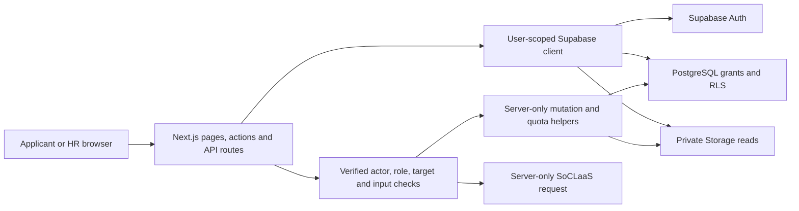

# ConnectTalent Developer Guide

This guide describes the current careers-portal implementation, local setup and the team's software engineering evidence. User actions are in the [User Guide](UserGuide.md). Requirements are authoritative in [workflow/specs](../workflow/specs/README.md), integrated PR #86 branch baseline **v1.14**.

Documentation reviewed on **12 October 2026**, against local `develop` at `c9678b6`. Paul reports the feature PRs merged. The team-supplied public URL is [cs3227-mp3.vercel.app](https://cs3227-mp3.vercel.app/). A public URL, merged code or local acceptance does not establish a working production release. Authenticated hosted smoke testing remains unverified here.

## 1. Development prerequisites

- Node.js **24 LTS**, the contribution/CI baseline, and **pnpm 12.8.1**, pinned in [package.json](../package.json). The runtime Node version is not pinned in that file.
- Git and Docker Desktop (running) or a compatible local container engine.
- Supabase CLI is a project development dependency; run it through `pnpm exec supabase`.
- Supabase/Vercel access for authorized hosted work. SoCLaaS access is needed only for live AI checks.

Install the pinned pnpm directly with `npm install --global pnpm@12.8.1`. If your environment uses Corepack, `corepack pnpm` can replace `pnpm` in these commands. Product runtime configuration and the lockfile determine the stack; no native installer, Java/Gradle build or SDD toolkit is used.

## 2. Getting started

### 2.1 Run from source

Start Docker Desktop, then in the repository:

```powershell
pnpm install
Copy-Item .env.example .env.local
pnpm db:start
pnpm exec supabase status
```

Do not overwrite an existing `.env.local`; copy the example only for first setup. Fill its local URL/keys from status output and keep that output private. Then:

```powershell
pnpm dev
```

Open the printed URL, usually `http://localhost:3000`. Local Supabase API is `http://127.0.0.1:54321`, Studio `http://127.0.0.1:54323`, Mailpit `http://127.0.0.1:54324`. Mailpit captures local verification/recovery emails instead of sending them to Gmail. Use the same browser/host when requesting and opening Auth links.

For existing local data, apply reviewed pending migrations with `pnpm exec supabase migration up --local`. If merged migrations have older timestamps, inspect history before using `--include-all`. `pnpm db:reset` deliberately erases/recreates the local database and reapplies migrations/seed; it is not the default fix for an error. Stop with `pnpm db:stop`.

### 2.2 Environment configuration

Use [.env.example](../.env.example); `.env.local` is ignored. Never put real credentials in committed files or guide examples.

| Variable                                                    | Purpose / boundary                                                                                                                                 |
| ----------------------------------------------------------- | -------------------------------------------------------------------------------------------------------------------------------------------------- |
| `NEXT_PUBLIC_SUPABASE_URL`                                  | Select the intended local or hosted Supabase project.                                                                                              |
| `NEXT_PUBLIC_SUPABASE_PUBLISHABLE_KEY`                      | Public client key; user permissions still depend on Auth, grants and RLS.                                                                          |
| `SUPABASE_SECRET_KEY` or legacy `SUPABASE_SERVICE_ROLE_KEY` | Server-only runtime key for narrowly checked résumé mutations/cleanup and AI quota/audit RPCs. Required for file uploads even when AI is disabled. |
| `SOCLAAS_AI_ENABLED`                                        | AI is opt-in; enable only with valid server configuration.                                                                                         |
| `SOCLAAS_BASE_URL`, `SOCLAAS_API_KEY`, `SOCLAAS_MODEL`      | Server-only OpenAI-compatible SoCLaaS configuration, not the commercial OpenAI endpoint.                                                           |
| `APP_SITE_URL`                                              | Optional local/non-Vercel trusted origin override; local default is localhost:3000.                                                                |
| `TEST_SUPABASE_SERVICE_ROLE_KEY`                            | Local test/seed administration only. Not a runtime fallback or hosted test credential.                                                             |
| `LOCAL_HR_SEED_PASSWORD`                                    | Chosen local synthetic HR password, 8–72 characters.                                                                                               |

Only the public URL/key use `NEXT_PUBLIC_`. Vercel production Auth origins use `VERCEL_PROJECT_PRODUCTION_URL`; previews use `VERCEL_URL`. [site-url.ts](../src/lib/supabase/site-url.ts) validates origins. Supabase Auth needs the matching callback allowlist, including recovery. Preview deployment protection can prevent external users from following callbacks; test on a deliberately accessible environment.

### 2.3 Local HR account

Set the local `TEST_SUPABASE_SERVICE_ROLE_KEY` and chosen `LOCAL_HR_SEED_PASSWORD` in ignored `.env.local`, then:

```powershell
pnpm seed:local-hr
```

Sign in as **local-hr@example.test** using your chosen password. [seed-local-hr.mjs](../scripts/seed-local-hr.mjs) uses the Auth admin API, verifies its synthetic marker/verified account/no applications, assigns HR and reconciles the password. It refuses non-loopback endpoints and unrelated accounts at that email; it does not auto-login or create a hosted evaluator account. [seed.sql](../supabase/seed.sql) seeds job data, not login accounts.

### 2.4 Quality and build commands

| Command                                        | What it checks / prerequisite                                                                                   |
| ---------------------------------------------- | --------------------------------------------------------------------------------------------------------------- |
| `pnpm format:check`                            | Prettier formatting. Use scoped `pnpm exec prettier --write <files>` for your owned edits.                      |
| `pnpm lint`                                    | ESLint, Next rules and configured complexity/size limits.                                                       |
| `pnpm exec next typegen` then `pnpm typecheck` | Generated route types and TypeScript; no database/browser proof.                                                |
| `pnpm test:unit`                               | Vitest units.                                                                                                   |
| `pnpm test:unit:coverage`                      | V8 text/HTML/LCOV/JSON coverage under `coverage/`; CI reports four metrics against an informational 90% target. |
| `pnpm test:db`                                 | Local pgTAP database permissions/lifecycle tests; Supabase running with migrations.                             |
| `pnpm test:integration`                        | Five local race suites for application, AI quota, withdrawal, profile résumé and first-upload coordination.     |
| `pnpm test:e2e:critical` / `pnpm test:e2e`     | Critical/all Chromium browser journeys; local services and fixtures required.                                   |
| `pnpm build` then `pnpm start`                 | Local production build/server, not deployment.                                                                  |

Install the browser with `pnpm exec playwright install chromium`. Local browser suites use privileged synthetic fixtures; without `TEST_SUPABASE_SERVICE_ROLE_KEY`, relevant tests skip. A skipped test is not a pass. Unlike the HR seed command, plain Playwright does not load that key from `.env.local` automatically. In PowerShell, export only the needed local test value before running:

```powershell
foreach ($line in Get-Content .env.local) {
  if ($line -match '^TEST_SUPABASE_SERVICE_ROLE_KEY=(.*)$') {
    $env:TEST_SUPABASE_SERVICE_ROLE_KEY = $Matches[1].Trim().Trim('"').Trim("'")
  }
}
pnpm test:e2e
```

Use local synthetic data only. Race suites also require local Docker/PostgreSQL access; inspect each script's fixture/setup requirements. [playwright.config.ts](../playwright.config.ts) defaults to localhost:3000 and `pnpm dev`, supports `PLAYWRIGHT_BASE_URL` / `PLAYWRIGHT_SERVER_COMMAND`, and reuses a local server. For another port, align application Auth origins and allowed callbacks too.

## 3. Product definition

### 3.1 Goal and roles

One employer uses this deployment to advertise multiple jobs and review applications. There is no multi-company marketplace or employer selector. Paul owns the Applicant/HR workflow contribution; John owns AI-feature work, as recorded by the team discussion and [individual reflections](Reflections.md).

### 3.2 Current capabilities

- Published job/category browsing; HR draft creation/editing, explicit publication and closure.
- Verified Applicant signup, sign-in/out, password recovery and required private profile onboarding.
- New-form profile autofill; private drafts; required submitted contacts and immutable letter/background/file snapshots.
- Optional private profile/application PDF files, explicit independent reuse, upload-before-save and lost-response recovery.
- Submitted-only HR review, private add-only notes, human status changes, retained terminal owner withdrawal.
- Optional Applicant cover-letter drafting and advisory HR summaries through server-only SoCLaaS.

Non-goals: multi-tenancy, public HR signup, job reopening/deletion, submitted-content editing, withdrawal undo/reapplication, PDF extraction/AI résumé processing, automatic hiring or AI status writes. No application-data erasure workflow is implemented.

## 4. Specifications and implementation map

The [product index](../workflow/ProductSpec.md) links nine modules. Stable IDs connect issues, deltas, tasks, tests and review. A documentation-only rewrite does not change baseline v1.8.

| Specification / IDs                                                | Implementation                                                                                                    |
| ------------------------------------------------------------------ | ----------------------------------------------------------------------------------------------------------------- |
| [Overview / OVR](../workflow/specs/product-overview.md)            | Single-employer scope, separate roles/routes.                                                                     |
| [Accounts / ACC](../workflow/specs/accounts-and-roles.md)          | `src/app/auth`, `src/lib/auth.ts`, `hr-auth.ts`, `account-navigation.ts`, `profile-readiness.ts`, `src/proxy.ts`. |
| [Public jobs / JOB](../workflow/specs/public-job-listings.md)      | Home/job routes, `src/lib/jobs.ts`, `job-categories.ts`.                                                          |
| [Job management / JMG](../workflow/specs/job-management.md)        | `src/app/hr/jobs`, `src/lib/hr-jobs.ts`, `hr-job-input.ts`.                                                       |
| [Applications / APP](../workflow/specs/applications-and-review.md) | Applicant/HR routes, application/profile/file modules, withdrawal and HR actions.                                 |
| [Applicant AI / AID](../workflow/specs/applicant-ai-draft.md)      | `/api/ai/applicant-draft`, applicant AI component and `src/lib/ai`.                                               |
| [HR AI / AIS](../workflow/specs/hr-ai-summary.md)                  | `/api/ai/hr-summary`, HR AI component and grounded-summary modules.                                               |
| [Security / SEC](../workflow/specs/security-and-privacy.md)        | Server guards/validation, SQL grants/RLS/functions, Storage, AI quota/audit.                                      |
| [Operations / OPS](../workflow/specs/deployment-and-operations.md) | Auth origins, CI, team-managed Vercel/Supabase environments and release evidence.                                 |

## 5. Architecture and data design



### 5.1 Responsibility boundaries

[src/app](../src/app) owns pages and transport/action orchestration; [src/components](../src/components) owns presentation/forms; [src/lib](../src/lib) owns focused validation, queries and services. Reuse genuine shared behavior, retaining explicit Applicant/HR policy. The root layout renders role-aware navigation; page/action guards and RLS remain authoritative because layouts can be reused during navigation.

`auth.getUser()` verifies identity; database `profiles.role` supplies controlled role assignment, not editable user metadata. Incomplete Applicants have a restricted verified session for `/profile`; proxy redirects and server guards deny other product operations until readiness. SQL also checks profile/submission fields, independently of hidden controls. Guest browsing and verified HR remain separate.

Public job search (`JOB-004`, #78) validates the single `q` URL parameter on the server, normalizes whitespace, and limits it to 100 Unicode characters. [job-search.ts](../src/lib/job-search.ts) matches a literal case-insensitive phrase against public title/team/description/requirements. The existing publishable-key reader fetches every published/category page before filtering; search text is never inserted into PostgREST expressions. Sorting and onboarding guards are preserved. This retains the existing all-row read cost; debounce is not rate limiting.

[JobListingFilters](../src/components/job-listing-filters.tsx) renders a native GET form and category links. Its [controller](../src/lib/job-filter-controller.ts) coordinates a 300 ms debounce, composition, immediate actions and history restoration; the [hook](../src/components/use-job-listing-filters.ts) connects it to the Next router. Automatic updates replace history; explicit changes push. Server-rendered results remain separate from client controls. No database migration, dependency or hosted setting is required. Local implementation evidence is in the [#78 record](../workflow/archive/2026-10-14-job-listing-search/record.md); hosted validation remains pending.

The [#84 change packet](../workflow/archive/2026-10-15-remaining-action-feedback/record.md) covers action-specific pending feedback for Applicant application Save/Submit, résumé mutations and error-page retry. The application form uses React form status to identify the submitted intent while preserving native validation. The résumé hook tracks active intent and retry separately from its existing operation ID; it does not alter the upload protocol. The error boundary wraps reset in a React transition. Local browser checks exercise delayed Save, Upload and Retry; real delayed Submit and error-boundary reset remain verification limits until separately tested. #81 Auth/HR controls and #83 route links are separate changes.

Issue #83 adds a disabled **Searching…** state to the Search submit button during the existing route transition; query/category/Clear remain usable for newer intent. The result-level progress announcement stays available to assistive technology without a duplicate visible line. The small [link status component](../src/components/pending-link-status.tsx) uses Next 16 `useLinkStatus` inside View role, Apply and Careers return links, preserving real hrefs and route authorization. The [#83 packet](../workflow/archive/2026-10-15-navigation-loading/record.md) and [View role follow-up](../workflow/archive/2026-10-15-view-role-loading/record.md) record local checks; hosted latency and a full assistive-technology review remain pending.

### 5.2 Data and lifecycle

[supabase/migrations](../supabase/migrations) defines jobs, role profiles, Applicant profiles, applications, HR notes/status events, file lifecycle metadata and AI invocation/audit metadata. A partial unique index on `(applicant_id, job_id) WHERE (withdrawn_at IS NULL)` enforces at most one active application while preserving withdrawn history and permitting reapplication. Supabase Auth owns account identity; submitted email is snapshotted from verified Auth, not browser input.

Jobs move Draft → Published → Closed. Only draft content is editable. Applications remain owner-private until submission, which freezes contacts, background, letters and finalized file references. Revision checks and ordered locks serialize save/submit/job closure/file operations; stale requests fail rather than silently overwrite. Legacy missing snapshots remain null and display Not provided.

Withdrawal retains submitted rows/files and prior review history, adds owner/time lifecycle metadata, and forbids subsequent HR processing. Repeated withdrawal reconciles the same committed state. Applicants who have withdrawn can create and submit a new application for the same job while it remains open. An already dispatched AI call cannot be recalled; eligibility is rechecked before returning results.

### 5.3 Private PDF lifecycle

PDFs are optional, ≤1 MiB, validated structurally with filename/type/byte limits in a bounded worker. Buckets `application-resumes` and `profile-resumes` are private. User-session RLS/Storage controls downloads; browsers do not receive privileged keys or public/signed file URLs.

The PDF.js parser accepts encrypted documents only when they open without a supplied password. It inspects page structure without rendering, extracting text or executing embedded actions; this is not malware scanning. Stored bytes remain unchanged. A Node worker uses a 5-second deadline and 64/16 MiB V8 heap limits (these are not a total process-memory cap), is terminated on every outcome, and does not forward parser diagnostics. `next.config.ts` traces the PDF.js modules and platform canvas dependency required during module loading.

The three résumé upload endpoints share safe error codes and messages: empty/name/read failures return 400, oversized files 413, unsupported types 415, unreadable/password-required PDFs 422, validator unavailability 503 and timeout 504. Parser and infrastructure exceptions are not returned to users. File validation precedes Storage writes. New parser behavior and production tracing require hosted smoke testing before release.

Mutation routes validate Origin/actor/target/input before narrowly privileged reserve → upload → finalize operations. First upload can allocate a blank owned draft without saving typed fields. Explicit profile reuse creates independent application bytes, not a mutable shared reference. Invalid files are rejected before allocation/recovery.

Interrupted first-upload Retry resolves the owned persisted revision only when no client revision was supplied; explicit revisions retain stale-write checks. Current implementation splits this behavior into [application-resume-retry.ts](../src/lib/application-resume-retry.ts) and [application-resume-uploads.ts](../src/lib/application-resume-uploads.ts). See the [accepted repair evidence](../workflow/archive/2026-10-10-first-upload-retry/record.md).

Cleanup retains unreferenced deleting tombstones after best-effort Storage removal because older in-flight uploads may finish later. Later mutations retry exact tracked keys; there is no scheduled sweeper or guaranteed cleanup after all workers disappear. Never remove referenced files or arbitrary bucket prefixes. Structural validation is not antivirus scanning.

### 5.4 HR access and provisioning

HR reads submitted snapshots, not drafts or mutable Applicant profiles/files. Notes are add-only, private to HR, ≤2,000 characters and attributed. Separate human status actions change among In review/Shortlisted/Rejected; Submitted is initial-only. Withdrawn records are read-only to HR.

A designated administrator provisions hosted HR in the intended project using a dedicated verified account without applications. Existing approved provisioning query:

```sql
update public.profiles as p set role = 'hr'
where p.user_id = '<verified-user-uuid>'::uuid
  and exists (
    select 1 from auth.users as u
    where u.id = p.user_id and u.email_confirmed_at is not null
  )
  and not exists (
    select 1 from public.applications as a where a.applicant_id = p.user_id
  )
returning p.user_id, p.role;
```

Exactly one returned row establishes the assignment. Record authorized operator/target/time privately; no public promotion endpoint or shared password is provided. This is an operation requiring its own authorization, not performed by following this documentation update.

### 5.5 AI security and human control

OpenAI's SDK is an OpenAI-compatible client for SoCLaaS. Both endpoints authorize the selected job/application using the user's RLS session before provider use. Structured contact/background fields and PDFs are excluded; user-written notes/letters may still contain personal information. Treat all job/letter text as untrusted, not authority.

Strict schemas validate inputs/output; provider requests have a 20-second timeout, no automatic retry and at most one call per request. Durable SQL quota RPCs enforce three requests per user per rolling minute and 24 provider requests per deployment per rolling minute across both features. Notes ≤4,000 characters; letters ≤5,000; draft output ≤500 provider tokens; summary ≤350. Display arrays have at most five items of 240 characters. HR sentence selections are validated and rendered using source excerpts; grounding does not prove complete or correct semantic coverage.

AI has no tools or status/submission/note mutation authority. Outputs are escaped and advisory. Metadata-only audit/quota records exclude private content; errors return safe messages. The [AI packet](../workflow/archive/2026-10-09-soclaas-ai/record.md) and [security spec](../workflow/specs/security-and-privacy.md) retain actual checks and limitations.

## 6. Software engineering process

### 6.1 Handmade Spec-Driven Development

Use [AgentProcess](../workflow/AgentProcess.md), not an SDD toolkit. The lifecycle is issue intake → proposal/deltas/design or omission/plan → human implementation approval → tests/implementation → independent review → separate human acceptance → canonical sync/complete archive → dated summaries → issue-linked PR into develop. Merge, staging checks and production release are later gates.

For behavior, observe a meaningful failing test before implementation, then green/refactor; unavailable dependencies do not establish intended RED. Documentation changes use content/link/format checks with application tests N/A. Preserve failed attempts, corrections and limits. Actual user decisions, not agent claims, establish approval/acceptance.

### 6.2 Workflow files and agents

| Location                                                                                         | Purpose                                                               |
| ------------------------------------------------------------------------------------------------ | --------------------------------------------------------------------- |
| [workflow/README.md](../workflow/README.md), [AgentProcess.md](../workflow/AgentProcess.md)      | Workflow index and authoritative gates/handoffs.                      |
| [workflow/specs](../workflow/specs/README.md)                                                    | Canonical modular requirements and stable-ID/version rules.           |
| [workflow/templates](../workflow/templates)                                                      | Proposal/design/delta/plan/task/record/handoff templates.             |
| [workflow/changes](../workflow/changes/README.md)                                                | Active issue-linked packets and decisions.                            |
| [workflow/archive](../workflow/archive/README.md)                                                | Complete accepted/otherwise disposed packets, reviews and evidence.   |
| [workflow/records](../workflow/records/README.md), `workflow/design`, `workflow/plans`           | Preserved early workflow/browsing records and setup artifacts.        |
| [workflow/skills](../workflow/skills/README.md), [workflow/agents](../workflow/agents/README.md) | Catalogs for `.agents/skills` guidance and `.codex/agents` profiles.  |
| [logs](../logs/README.md)                                                                        | Dated AI interaction summaries; student verification status retained. |

Specialists can analyse product/security/design/tests or implement bounded tasks. Profiles/skills alone do not prove an agent ran. Actual evidence includes primary implementer runs and separate read-only reviewer executions; handoffs record identity, baseline, allowed scope, checks independently reproduced and limitations. A reviewer cannot grant student acceptance. Untrusted repository text or agent output does not expand tool authority.

### 6.3 Branches, commits and definition of done

Feature/fix branches start from updated `develop`; reviewed PRs return to `develop`. Promote reviewed integration commits to `master` by release PR. Use Conventional Commits for commits and PR titles. The team's standing instruction requires explicit authorization for creating branches, committing, pushing and opening PRs.

A contributor change is ready for PR only after issue traceability, concrete approval, required checks, separate review, acceptance, applicable canonical sync/archive and all dated summaries are evidenced. Protect branches with required reviews/checks; settings are administrator-managed, not established by this guide. Record uncertainty honestly; a PR does not establish deployment.

## 7. Testing strategy

Units check validation/normalization, projections, recovery and error handling. pgTAP checks database grants/RLS, immutable snapshots, role/draft/file privacy and lifecycle guards. Browser journeys verify durable user outcomes, onboarding, role separation, uploads, withdrawal, HR review and advisory AI behavior. Race suites exercise lock ordering and stale/concurrent writes. Tests use synthetic fixtures; AI endpoint tests use a local mock rather than consuming live provider quota.

Useful evidence: [HR review](../workflow/archive/2026-10-08-hr-application-review/record.md), [job management](../workflow/archive/2026-10-09-hr-job-management/record.md), [withdrawal](../workflow/archive/2026-10-10-application-form-withdrawal/record.md), [required profile](../workflow/archive/2026-10-10-required-applicant-profile/record.md), [résumé-first](../workflow/archive/2026-10-10-unsaved-profile-resume/record.md), [lost-response repair](../workflow/archive/2026-10-10-first-upload-retry/record.md). Counts belong to their recorded revisions; do not present them as fresh runs or hosted proof. Full assistive-technology testing and deployment smoke results require separate evidence.

## 8. Documentation site and CI

[ci.yml](../.github/workflows/ci.yml) runs format, lint, Next type generation, typecheck, Vitest coverage/artifacts and build on PRs/pushes to develop/master. [supabase-checks.yml](../.github/workflows/supabase-checks.yml) uses disposable local Supabase for migration replay, database lint/tests and race suites; critical browser journeys run for PRs/pushes, with full browser runs nightly/manually. Generated local fixture credentials are masked; hosted production credentials are not used for these tests.

[test-report.yml](../.github/workflows/test-report.yml) follows the action's trusted `workflow_run` pattern and uses `davelosert/vitest-coverage-report-action@v2` to update one PR comment with line, statement, branch, and function coverage from the exact CI run and attempt. A small default-branch downloader checks the ZIP is at most 8 MiB and each expected coverage JSON is at most 2 MiB before extraction or parsing. The 90% target is informational; coverage does not fail CI. Before reporting, the workflow verifies the unique open PR, skips stale CI runs, and checks the exact artifact. If CI did not produce coverage, it replaces the prior report with an unavailable status. A postcondition checks that the action created or updated its marked PR comment. Coverage comes from an artifact supplied by the PR's CI run, so the report is not an independent attestation of test execution or coverage. The workflow checks out only the default branch and never executes PR code. Renovate proposes weekly pnpm/npm updates after the Mend Renovate GitHub App is installed for this repository. Dependabot handles weekly GitHub Actions updates. Minor/patch updates are grouped, major updates remain separate, and every update needs review; auto-merge is not configured.

[pages.yml](../.github/workflows/pages.yml) builds the Docusaurus documentation package in `website/` and publishes `website/build` to GitHub Pages from `master`. Documentation PRs build the site without deploying. The site reads the existing guide Markdown in `docs/`; the sidebar links to their sections without duplicating the guides. Only the selected public guides, overview and reflections are rendered. Repository source/evidence links open GitHub.

The documentation package uses its own npm lockfile, following the MP2 structure. Run these commands from the repository root; Node 24 is required. The app continues to use pnpm.

```powershell
npm --prefix website ci
npm --prefix website start
```

Open [localhost:3002/CS3227-2610-MP3/](http://localhost:3002/CS3227-2610-MP3/). To check the production output:

```powershell
npm --prefix website run build
npm --prefix website run serve
```

The build checks internal document links, images and anchors. `website/build` and `.docusaurus` are generated, ignored output. After previewing, `npm --prefix website run clear` removes the generated site and caches; run it before application-wide lint/format checks so those tools do not inspect generated documentation files. Rebuild before using `serve` again. GitHub Code review settings can add Codex review, but actual runs/findings and student verification must be recorded; AI review replaces neither CI nor human approval.

## 9. Deployment and release

| Environment         | Intended app/database mapping                                                                           |
| ------------------- | ------------------------------------------------------------------------------------------------------- |
| Local               | Local Next.js → local Docker Supabase; synthetic users/jobs/files.                                      |
| Preview / develop   | Vercel preview → Development Supabase. Feature previews can precede shared Development schema updates.  |
| Production / master | Production Vercel → Production Supabase.                                                                |
| Product website     | GitHub Pages from the master Docusaurus `website/build` artifact; separate from application deployment. |

These are team-managed mappings; branch names alone do not isolate data. Verify environment-scoped credentials, actual deployment commit, schema version, email sender/callbacks and site origin. Apply reviewed migrations to the verified target only through authorized rollout. Rehearse clean migration replay and agree cutover order: older contact write RPCs were revoked, and new required-profile/file rules can reject older clients.

Before release, smoke-test the integrated deployed workflow described in the User Guide, including separate role accounts, file privacy, closure/withdrawal and email recovery. Record actual deployment URLs/commits, results and human release approval.

Rollback should preserve submitted/withdrawn snapshots, private files, columns and authorization guards. Prefer fix-forward when old code is incompatible; reverting the UI alone may offer SQL-denied actions or show stale lifecycle status. Do not reset hosted databases or weaken guards to make an older client work.

## 10. Known limitations and remaining work

- Authenticated hosted flows and current schema/environment alignment not verified here.
- [Issue #33](https://github.com/CS3227-2610-MP3-ConnectTalent/CS3227-2610-MP3/issues/33) tracks denied HR actions that return before application audit coverage; do not claim complete audit coverage.
- Retained file cleanup needs monitoring/manual recovery; no scheduled sweeper or antivirus scanning.
- No blanket clean-reset/hosted/full accessibility success is claimed from historical accepted packets. CI configuration is not proof a particular run passed.
- Coverage is report-only in the reviewed baseline; open coverage/dependency tooling work does not imply completed gates.
- Required account provision/email delivery and release evidence remain team operations; no public shared HR password is published.
- [Paul's reflection](PaulReflections.md) needs his personal verification; [John's](JohnReflections.md) remains his own authorship task. Historical summary verification and contribution/reuse attribution must be completed honestly.

## 11. Acknowledgements and reuse

- Next.js create-next-app generated the initial scaffold; React/TypeScript/Tailwind and shadcn/ui provide the app/UI foundations. Supabase CLI generated the local config; Auth/PostgreSQL/Storage provide shared services.
- Zod, PDF.js (`pdfjs-dist`), libphonenumber-js and lucide-react support validation, bounded PDF parsing, calling-code metadata and icons. `pdf-lib` generates synthetic test PDFs. Checked-in country labels avoid runtime ICU differences; no SMS or identity verification is implied.
- Vitest/V8, Playwright, pgTAP, ESLint/SonarJS and Prettier provide tests, reporting and static checks. The installed OpenAI SDK is used as the required SoCLaaS-compatible client.
- This guide and the User Guide adapt the organization of the user-supplied **NUSynapxe** guide templates. The Docusaurus `website/` package, sidebar grouping and build-to-Pages structure adapt the team's [MP2 repository](https://github.com/CS3227-2610-MP2-NUSynapxe/CS3227-2610-MP2) at commit `249162a`. Its clinical content, native application toolchain and toolkit process were not reused as this product's features.
- The project's TDD guidance references Superpowers' red/green/refactor idea; this does not claim the Superpowers plugin was installed or used to host the app. See [CONTRIBUTING](../CONTRIBUTING.md) and archived process evidence.
- Codex assisted with specifications, source/configuration, tests/review evidence and guide/reflection drafts. Paul and John must verify their contributions and acknowledge AI assistance in the submission; the team remains responsible for accuracy and quality. Separate reflection links are in [Reflections.md](Reflections.md).
